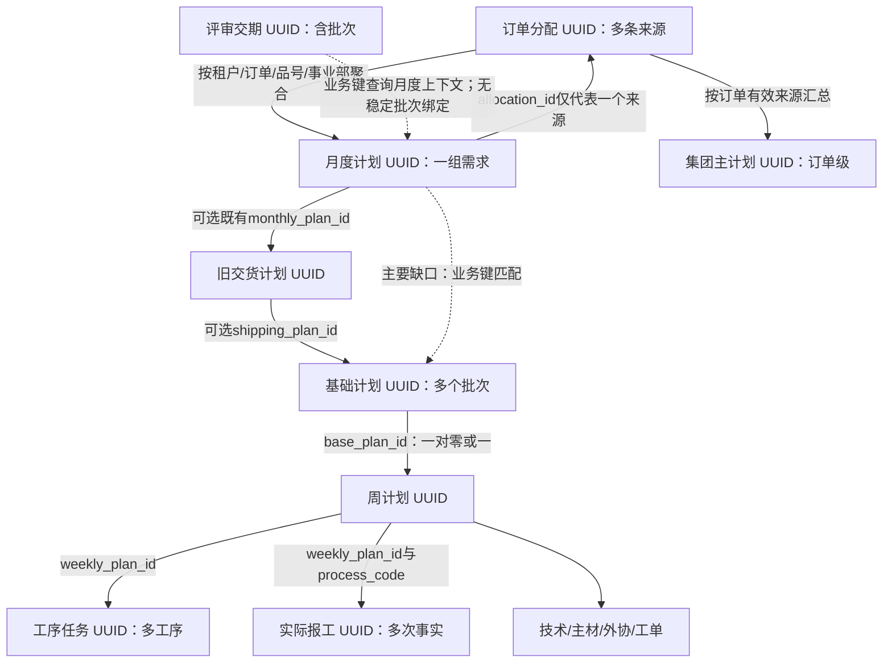
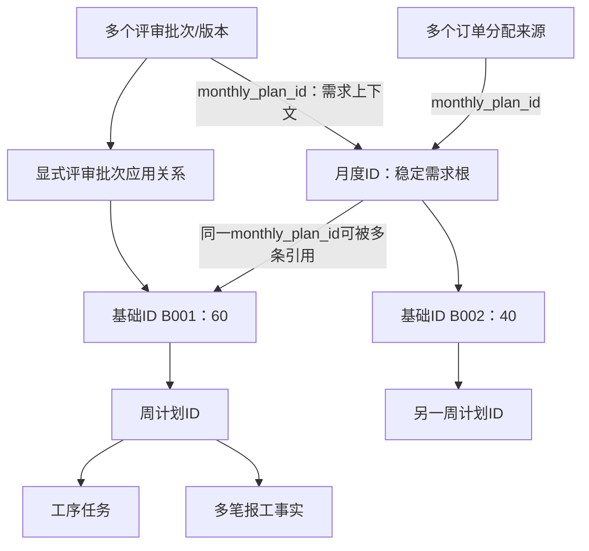

# KDOS统一需求ID与生产计划ID架构评估

- 日期：2026-11-05（Asia/Shanghai）。评估基准：main `d926f90bd20b9695e02449554a7f321be7fbd37e`。
- 结论：**推荐方案A，复用 `mps_monthly_plans.id` 作为需求身份，复用 `mps_base_plans.id` 作为生产批次身份。** 不新增需求主表，不给周计划、工序任务和报工重复增加 `demand_id`。
- 本轮完成代码/结构阅读、生产只读聚合、历史映射分类和设计。**未开发、未执行任何Migration、未回填ID、未触发同步、未部署。** 后文新增字段、Command、约束及测试均为实施建议。
- 工作区已有方案A发布兼容修复尚未完成，本评估未修改、提交这些代码。统一ID改造不是1A＋1B发布前置；继续原方案A最小兼容修复路线。

## 1. 证据与范围

阅读项目AGENTS、`kdos-form-platform`、`kdos-form-validation`、`kdos-task-orchestration`，以及任务台账、第一阶段设计、发布评估、进度记录、Migration 106/107/108/112/116/118/119/120及下列核心实现：

| 范围 | 现有文件（相对仓库根目录） | 已确认行为 |
|---|---|---|
| 分配需求与集团/月度投影 | `apps/api/src/modules/master-plan-system/master-plan.allocation-source.ts`、`master-plan.allocation-projection.ts` | 获批且未归档分配按订单/品号/事业部合并；已有月度ID保留；代表分配ID不是全部来源集合 |
| 月度→基础 | 同目录 `master-plan.monthly-base.ts` | 仍按业务字段匹配；多个基础批次报冲突并保留；审计 `syncValues` 三方合并保护人工值 |
| 基础→周→执行 | 同目录 `master-plan.sync.service.ts`、`master-plan.work-order.service.ts` | 周计划以base_plan_id定位；执行按weekly_plan_id；1B已停止同步改写报工历史上下文 |
| 普通编辑/导入/查询 | 同目录 `master-plan.application.service.ts`、`master-plan.query.service.ts`、`master-plan.config.ts` | 权限、字段范围、expectedVersion、审计及待报工查询必须保留 |
| 评审交期 | 同目录 `review-due-date.application.service.ts`、`review-due-date-import.application.service.ts`、`review-due-date.query.service.ts`、`review-due-date.domain.ts`、`review-due-date-source.ts` | 独立业务表；批次维度；版本纠错；当前没有向所有基础批次广播交期 |
| 进度及入库 | 同目录 `master-plan.order-progress.service.ts`、`master-plan.dashboard.service.ts`、`master-plan.monthly-inbound.ts` | 查询派生进度与入库事实；跨工序报工数量不能简单求和代表成品履约 |
| 生命周期与保护 | 同目录 `master-plan.lifecycle.service.ts`、`master-plan.lifecycle-sql.ts`；Migration 119/120 | ID绑定也必须经过执行事实和生命周期保护；新关联字段与119存在前向兼容要求 |
| 契约/页面 | `packages/contracts/src/index.ts`、`master-plan-order-progress.ts`、`review-due-dates.ts`；`apps/web/src/modules/master-plan-system/MasterPlanPages.tsx` | 未来只暴露必要关联和预览；继续共用表格/权限/导出机制 |

生产诊断通过现有API容器环境连接PostgreSQL，每次显式 `BEGIN ISOLATION LEVEL REPEATABLE READ READ ONLY`、设置租户上下文及超时、最终 `ROLLBACK`。只执行SELECT；未调用会执行同步的接口。凭据不输出，原始诊断及634个固定ID保存在ignored `test/mps_unified_id_assessment/`，不进入Git。

主要数据快照为2026-11-05 **21:47:35、21:51:47 CST**，代表父记录补核21:57:42 CST；租户KAINAN。不同快照不是全生产跨时点锁定，未来实施须重新预览真实版本。当前生产118/119/120的迁移记录均为空，仍以既有发布评估为准；本轮未重新进行上线预演。

## 2. 当前真实关联

### 2.1 已有ID可直接复用

- **分配ID**：`mps_order_allocations.id`是来源行身份，导入来源信息另有保留；归档保留原ID。多行分配可贡献同一需求，不能把单行ID等同需求ID。当前需求按每个有效分配行计一次，不按导入批次重复汇总。
- **月度ID**：当前表没有月度期间字段；`order_date`是订单日期及日历筛选依据。Migration112约束为 `UNIQUE NULLS NOT DISTINCT(tenant_id,order_number,item_code,division_id)`。同一订单品号不同事业部是不同需求；多交期由下游批次承载。
- **月度重建风险**：正常分配投影更新已有月度ID，不删除来源消失的历史记录；生产审计未见月度删除动作。120进一步禁止计划物理删除，但尚未部署。未来必须将“不通过重建更换需求ID”固化到所有写入口，不能仅依赖当前调用习惯。
- **基础ID**：当前数据库及手工新增允许同订单品号多个交期编码/批次，月度同步却在同事业部匹配多条时停止该组更新。业务规则应允许1:N，现有自动匹配规则需调整。
- **周计划**：`base_plan_id`非空，现有 `UNIQUE(tenant_id,base_plan_id)`，每个基础计划至多一张周计划。已有FK主要引用全局ID，查询仍须同时校验tenant；生产未发现跨租户/悬空关联。后续对必要边补充复合租户FK。
- **工序/报工**：工序任务以 `(tenant_id,weekly_plan_id,process_code)`唯一；报工按weekly_plan_id＋process_code稳定追溯工序，不是直接用任务行ID外键。已有多次报工ID保持独立，不因统一ID替换这些键。
- **集团**：`mps_group_plans`是订单级，不是单品项需求级。继续按订单聚合有效子需求，不能加一个指向某需求的唯一外键代表整张订单。

### 2.2 现有中间链与别名

`mps_shipping_plans.monthly_plan_id`已有租户复合FK；基础的 `shipping_plan_id`可选。6,811条基础中5,578条没有shipping关联，不能要求全部先补造交货计划才能建立需求父关系。

`mps_order_line_source_aliases`映射ERP来源系统/账套/来源键到 `mps_erp_order_lines.id`，保护ERP行身份，**不是订单文本的通用别名表**。残留计划诊断中去 `23xx-` 前缀及 `-1` 后缀的规则、一次性 `groupPlanAliases` 均不能充当永久需求映射依据。

## 3. 生产只读规模与匹配结论

### 3.1 需求与批次

| 项目 | 数量 | 解释 |
|---|---:|---|
| 订单分配总行 / 归档 / 未归档 | 6,813 / 2,410 / 4,403 | 未归档不等于有效需求 |
| 未归档且已审核来源行 | 4,377 | 形成4,197个结构有效需求组 |
| 多来源需求组 | 162 | 每组最多6条来源，不是162个重复需求 |
| 当前投影可用 / 被保留历史或人工归属阻断的组 | 4,087 / 110 | 可用组均已有月度记录；缺少月度为0 |
| 月度计划 / 集团订单计划 | 6,278 / 700 | 不可用总月度数量代替当前有效需求数量 |
| 月度引用已归档来源 / 引用当前已审核来源 | 2,176 / 4,088 | 与投影可用组不是同一筛选；另有来源身份漂移8条 |
| 月度按订单品号分组 | 6,245 | 33组跨事业部；不是同一事业部跨月多需求 |
| 基础计划 / 基础业务三元组 | 6,811 / 6,763 | 48组有多基础计划，共96条，每组2条 |
| 多基础组中交期不同 | 1组 | 交期相同仍可能是独立批次，不合并 |
| 周计划 / 工序任务 / 实际报工 | 3,284 / 27,780 / 5,025 | 待报工是查询投影，不是新的事实主表 |

所有48个多基础组，按当前精确业务三元组都**没有对应月度记录**。因此不能用本次数据证明这48组数量已平衡，也不能把缺失需求按0算成超排；先确认父关系，再计算数量差额。现有有效来源组未见订单日期跨月组合；数据库本身也没有独立期间粒度，这支持复用月度ID，但不证明未来业务永远不需要分期。

分配按精确三元组可匹配月度：6,596行，无法匹配217行；4,377条当前已审核来源全部有精确月度候选。另有**1个分配ID被2条月度记录作为代表父行引用，仅其中1条与分配当前身份一致**。不能盲目反向把这两条月度都当作当前需求，也不能据此复制来源数量。

### 3.2 基础→需求映射：结构与安全分类分别统计

结构检查先核对显式shipping→monthly链的租户和身份；显式链冲突时禁止退回文本匹配：

| 结构分类 | 基础条数 |
|---|---:|
| 显式旧链存在且身份一致 | 545 |
| 无冲突显式父链，精确三元组唯一候选 | 5,519 |
| 显式链身份冲突 | 3 |
| 无精确父候选 | 744 |
| 合计 | **6,811** |

结构上可唯一定位6,064条，不代表6,064条都能直接确认为有效需求。结合来源是否当前可用、父记录身份与客户一致性，得到互斥分类：

| 迁移预分类 | 基础条数 | 有实际报工的基础数 | 这些基础对应报工数 | 后续处理 |
|---|---:|---:|---:|---|
| 可自动确认的候选 | **4,083** | 47 | 63 | 受控命令重新核验版本、权限和执行保护后才可写入 |
| 应保留历史 | **1,981** | 1,663 | 4,942 | 可保留/确认历史父关系，不激活来源或需求 |
| 需人工确认 | **744** | 14 | 17 | 无精确父候选；保留原ID和事实，挂待确认异常 |
| 身份/执行事实冲突 | **3** | 3 | 3 | 禁止自动改绑；列入受控业务核实 |
| 合计 | **6,811** | **1,727** | **5,025** | 本轮实际建立关联为0 |

5,025条报工均可通过现有weekly/base ID追溯，未发现悬空、跨租户或订单/品号/事业部漂移。其中5,005条可继续找到单一结构合法月度候选，20条落在17条待确认/冲突基础上。它们仍能查询历史，不能因为父需求未确认而从历史统计中隐藏。

别名风险：月度按上述正则归一化后，有12组出现多个不同原订单号；744条无精确父基础中411条仅有1个归一化候选、6条各有2个、327条仍无候选。**411条不能因此自动迁移**。ERP来源别名1,149条对应1,145个ERP行ID，未见断链/跨租户，但不能替代这部分人工订单归属核实。

### 3.3 652/634及历史基准保护

- 634个固定基础ID全部存在，事业部检查无漂移；身份/原关联和数量指纹与1B最终受限基准一致。
- 其中236条属于本次自动候选，398条精确月度父缺失。不得为提高匹配率替换这398个ID或按别名强行合并。
- 652条来源明细沿用已确认保护基准，本轮未重新读ERP逐条清点，不能把634条基础检查等同于652条来源全量复核。
- 3组后续人工数量变更保留现状；旧验收数量不能作为自动回退目标。真正迁移前再做ID/数量/报工/入库/工艺指纹与差异预览。
- 既有11条Outbox/日志矛盾、1条旧RUNNING、25条非工序制造方式报工及其中3条无启用工序问题属于既有第一阶段调查项；本轮不修复，也不将它们与上述20条需求追溯缺口混作同一口径。

## 4. 三种方案比较与选择

| 维度 | A：月度ID作为正式需求锚点 | B：新增独立需求实体 | C：仅补缺失父关系 |
|---|---|---|---|
| 身份语义 | 符合当前三元组及现有唯一约束，无期间主键 | 可支持独立需求版本/期间；当前与月度重复 | 各节点继续各自解释需求，需约定关系边含义 |
| 必要结构 | 基础父ID、来源成员ID、评审父ID；批次评审关系按需 | 至少需求表、月度外键、来源/基础/评审关联 | 最小可先仅补base.monthly_plan_id |
| 建议Migration批次 | 核心1批；评审应用关系另1批，需保护函数前向兼容 | 至少核心实体及回填/消费者多个批次 | 初始1批，但之后来源/评审仍需补齐 |
| 历史适配 | 原月度/基础/报工ID保留，无法确认者留空 | 还需为每个旧需求选择/生成新根ID | 初始成本最低，旧来源代表行和多评审歧义仍存在 |
| 同步简化 | 明确需求成员与1:N批次，取消反复全文本定位 | 同样可简化，但多一层生命周期/权限/汇总维护 | 能简化部分链路，不能独立解决统一需求归属 |
| 人工成本 | 集中审核744＋3及历史关系，无重编号 | 除同样审核外还要确认新实体与月度对应 | 短期低；长期继续逐链核对来源 |
| 长期成本/风险 | 最低且满足本次业务；须禁止月度重建 | 当前投入和双实体不一致风险较高 | 适合作为A的第一小步，不作为最终身份模型 |

**选择A，以C式小步实施。** A与C不是互斥的SQL技巧：区别是是否正式承诺月度UUID就是稳定需求身份，并把全部来源成员、基础批次及评审上下文纳入同一解释。当前无需独立需求主表。仅给基础补父ID可作为A首步，但不能宣称已完成多来源、评审批次联动。

适用边界：未来若“同三元组同时有多个独立需求生命周期/分期订单、月度记录必须周期性重建”等成为正式需求，再评估B；不能在现有月度上随意新增月份唯一维度后继续把每个月份行都叫同一需求ID。

## 5. 推荐目标结构及具体字段

| 表 | 建议新增/复用 | 规则 |
|---|---|---|
| `mps_monthly_plans` | 复用id及allocation_id、version | id代表需求；allocation_id暂留作兼容代表来源，不能再据此推算全部成员；不新增第二个demand UUID |
| `mps_order_allocations` | **新增nullable monthly_plan_id** | 多条来源→一个已确认需求；先有分配再由投影同事务建立需求/成员关系；归档保留关联；不是输入任意父ID的普通可编辑字段 |
| `mps_base_plans` | **新增nullable monthly_plan_id** | 多条基础→同一需求；此列不加按需求唯一约束，保留原基础id、shipping_plan_id和交期编码 |
| `mps_review_due_dates` | **新增nullable monthly_plan_id** | 一条评审记录仅确定需求上下文，不推定对该需求所有基础批次生效 |
| `mps_review_base_plan_links`（建议命名） | **仅在实现评审批次应用时新增关系表** | tenant_id、review_due_date_id、base_plan_id、applied_review_version、version、审计字段；同一评审可显式选择多条基础，目标必须属同一需求；不保存第二套评审事实 |
| 周/工序/报工/工单/技术主材外协 | 复用base_plan_id、weekly_plan_id、process_code及现有ID | 不层层增加demand_id；通过稳定父链查询；历史身份按各自权限和快照保护 |
| 集团主计划 | 复用订单级id | 从有效需求/来源按当前口径汇总，禁止一对一绑定某个品项 |
| ERP来源别名 | 复用现有源别名表 | 只解决该表已定义的ERP行来源身份，不用正则生成需求关系 |

对新增链接建立 `(tenant_id,parent_id)` 索引和指向父 `(tenant_id,id)` 的复合FK；已有父复合唯一约束先核实再复用。评审批次关系去重 `(tenant_id,review_due_date_id,base_plan_id)`，并约束已应用版本不得大于评审当前版本。一个基础多条评审历史可保留，但“当前选用哪一条及哪个版本”必须显式确定，不按更新时间擅自取一条。关联表适用RLS、权限、optimistic version、审计，审计保留每次应用/撤回，不用级联删除历史。

新链接暂可空：空表示未确认，不表示没有需求或数量为0；不能先设NOT NULL再凭文本强填。业务Contract可只读返回 `demandId=monthly_plan_id` 和已有 `basePlanId`，名称统一语义；数据库不存同值双列。

## 6. 多基础计划及数量管理

### 6.1 基本数量视图

所有数量用PostgreSQL numeric/Decimal。按已确认需求ID计算：

- `D`：当前有效、已审核、未归档的来源贡献总量；每个allocation.id仅计一次。多评审版本、多工序、多周次不增加需求。
- `P`：同需求已确认纳入排产占用的基础计划数量，每个base.id仅计一次。
- `delta = D - P`：保留有符号差额；`待分配=max(delta,0)`，`超额分配=max(-delta,0)`；另显示人工计划值与上次syncValues差异，不用差额倒改来源。
- ON_HOLD仍占用已承诺排产量，避免暂停被自动补造新批次；LEGACY_RETAINED未确认前显示数量归属待确认，不擅自纳入或按0释放。

100件拆60＋40后增至120：待分配20，保持两批原值；允许操作者选择“新批次20”或明确选B001/B002增加。100减至80：显示超额20及各批已执行风险，由有权限者显式选择减少对象/数量或关闭剩余；不按ID、日期或FIFO擅自扣某一批。

| 场景 | 建议行为 |
|---|---|
| 仅一基础、无人工覆盖、当前值等于上次自动基线 | 身份/生命周期/执行风险均合法时可按现有同步所有权规则更新数量；保留审计、版本和前后差额 |
| 单基础有人工作业/数量覆盖，或缺少可信自动基线 | 不因“只有一条”就覆盖；输出差额待确认 |
| 多基础新增需求 | 输出待分配量，不选择增量落点；显式输入每批分配量及expectedVersion |
| 多基础需求减少 | 逐批预览；已有事实不减少或搬移，不能让普通同步自行消化超额 |
| 不同交期批次 | 各批保留交期及人工值，不取需求级最大/最小日期广播 |
| 人工拆批/合批 | 显式源/目标ID、数量、原因、幂等键；合批只转移可调剩余量；已执行批次ID和事实不删除、不重挂 |
| 来源归属不明或数量不一致 | 标记异常并保留；不以自动改数量使差额归零 |

### 6.2 已报工/入库与取消后的防重复排产

`D-P`适用于未释放批次或完整计划占用。取消已有履约的基础批次时，不能简单从P移除整批后重建已经完成的数量。后续数量预览应明确：

1. `F`为该需求**正式、去重的成品履约/入库抵扣量**，含已关闭批次事实；不能把各工序报工数累加当成成品数。
2. 对仍占用剩余需求的基础，`R_b=max(计划数量_b-已归属履约抵扣_b,0)`；同一入库事实只能归属一次。
3. `有效占用=F+ΣR_b`；`可再排差额=D-F-ΣR_b`。避免同时用完整P再扣F造成双扣。
4. 若入库仅能按订单品号确认、不能按批次可靠归属，显示“批次履约待确认”，阻断自动释放/补排，不虚构批次入库分摊。
5. 另列“实际超交”和“尚未执行的超排”，不把超交伪装为负待办。120取消状态仍保留原计划数量，不用数量0表达取消。

例：需求100，单批计划100、已确认成品40，关闭剩余60后该批不再占用R，F仍为40；若需求本身仍有效则可再排60。若**整个需求**取消，则不得从“剩余60”自动新建批次；需求状态/来源有效性另外限制生成。取消批次与取消需求必须是两种业务意图。

现有monthly-inbound按核实ERP来源读取入库事实，不能改写为以报工汇总假装入库；本设计不承诺当前数据已满足全部批次履约分摊。建议在现有计划页面增加派生“待分配需求”视图：需求ID、D、P、F、R、有符号差额、人工偏差、确认状态及阻断原因；先做Query，不为这些可计算总量新建事实台账。

## 7. 订单评审交期的真实粒度与目标方案

### 7.1 当前事实

- 独立主表 `mps_review_due_dates`，唯一键 `(tenant_id,division_id,order_number,batch_number,drawing_number)`；drawing_number对应业务品号。另有不可修改初始source_*键。
- 同一键的重新评审/纠错通过同一UUID和version更新，不能每次评审都新增一个需求；不同批次可以是不同评审行。
- `due_date`是客户交期（116拆出Excel F列）；历史稳定字段名 `inbound_date`当前界面语义为“最新交期”，**不是仓库真实入库日期**。
- `previous_inbound_date`、change_count自106起为人工维护；不能从当前值反推完整评审事件。`mps_review_due_date_changes`保留不可变历史，审计另存更新前后。
- 查询中的order_date、product_review_due_date是精确且唯一匹配月度后读取的虚拟字段，不是已建立FK。普通修改/Excel导入目前不向基础/周计划自动广播评审日期。

### 7.2 生产结果及不能自动推断的部分

3,608条评审，3,590个订单品号事业部组；18组存在多批次，共36条，其中2组交期不同。1,650条有唯一精确月度候选，1,958条没有。按三元组有唯一基础候选1,653条、无基础1,955条。

但 **batch_number与base.delivery_number::text严格相等匹配为0**。当前3,608个批次号均为两位数字；数字化去前导零后虽有1,569条单一候选，也没有业务合同证明这两个编码等价，不能因此绑定。评审源身份变更、version>1、手工修改审计、不可变交期事件当前均为0；有2次确认导入、4,722条创建审计，多于当前行数，不能把创建审计条数当作活跃评审数量。1,506条due_date与inbound_date不同，两种日期不可相互替代。

### 7.3 关联和交期应用

1. 先确认 `review.monthly_plan_id`，只提供需求上下文。1,650条是候选规模，不是已通过批次归属的迁移量。
2. 需要影响基础批次时，通过显式review/base关系选择一个或多个具体base.id；显示评审版本、目标批次、当前日期和建议日期、当前工艺锁/执行事实。
3. 尚未确认目标、同批存在多个评审候选、源键编辑后与父关系不一致时，显示待确认，禁止广播全部基础。已绑定评审修改订单/品号/事业部/批次必须重新预览/拒绝冲突，不能只改文本却继续沿用旧关系。
4. 评审更新先保存评审事实；向所选批次应用是独立获权Application Command，带评审版本、各基础expectedVersion及幂等键，重检权限、身份和工艺锁；同事务写计划变更审计及Outbox，不改报工。
5. 已报工仍可按正式规则调整当前计划交期/数量；理论工序交期只按已锁定工艺快照107/108合法重算，不重读新工艺重建工序，也不改报工历史日期。
6. 保留不可变历史及audit；评审当前行version变化后，关联中的applied_review_version不自动跟随，显示“有新评审待应用”。审计保留实际应用的日期快照，不凭当前行假装还原旧版。
7. 导入服务存在受限的初始replace路径，历史事件为空时会删除再建评审主表。未来有任何需求/批次关系或应用记录时必须禁止该替换，改为按稳定ID合并；不能通过级联删除关系让替换通过。

## 8. ID优先的联动边界

| 变更 | 未来处理原则 |
|---|---|
| 新增分配 | 原来源UUID入库；在权限/身份校验后同事务创建或取得唯一月度ID，建立成员关系；ERP仍有订单不等于KDOS批准了新需求 |
| 来源/数量更新 | 按来源ID定位所属需求，重算有效成员一次；按第6节输出差额，禁止多批次整组覆盖 |
| 新增基础 | 明确monthly_plan_id及数量，按需求锁定、查重、占用校验；正常执行仍需已具备现有周计划准入字段 |
| 交期/产品普通属性变化 | 稳定ID不变，保留人工所有权；评审交期只作用于明确批次 |
| 真正更换订单/品号/事业部 | 原需求和已执行计划不能普通编辑改绑；跨原/目标事业部校验并进入受控身份处理；独立新需求用新根ID，旧事实留原链 |
| 纯显示更正/已证实来源别名 | 经审计的身份确认，不靠文本变化新建需求，也不把真实独立订单合并 |
| 取消/恢复 | 原ID保留；复用1C预览、权限、状态与消费者完整性；统一ID本身不开放取消写入，不能恢复来源就自动激活所有旧批次 |
| 拆批/合批/多次报工 | 复用原base/weekly/report ID，按第6节显式分配；已发生事实不搬移 |
| 新增有效报工 | 按稳定weekly_plan_id和process_code、当前准入/状态/权限校验；保存当时上下文，后续只读关联当前计划 |
| 同步重试/并发 | 继续使用1A Outbox、租约、fencing和结果核验；以tenant＋需求ID锁协调数量分配与同步，沿用交期编码锁防新增竞态；状态/版本变更则重新预览 |

ID-first选择顺序：已填明确父ID→校验身份/租户/状态；无明确父ID但旧shipping链有效→候选；均无才做精确业务键待确认。**已经填入的父ID冲突时必须阻断该记录，禁止文本回退把错误掩盖。** 历史查询可以返回未确认来源及原因，但不顺带生成新生产任务。

稳定ID不会解决：取消后的需求有效性、人工批次数量分摊、评审日期选择、入库批次归属、工艺锁、权限或旧日志失败。这些仍需1A/1B/1C及正式业务规则，不改成“有同一ID就可自动覆盖”。

## 9. Migration建议与第一阶段兼容

### 9.1 前向兼容缺口（实施前必须解决）

119的 `mps_guard_executed_plan_identity()`用JSON比较 `monthly_plan_id`，适用于基础、分配等父表。**新增该列后，已执行对象的NULL→父UUID回填也会被当成身份变化拒绝。** 仅加列/FK后直接UPDATE不是可执行方案。

需要新的前向保护函数/受控初始链接机制：只允许在原父为空、租户一致、确认订单/品号/事业部/客户、旧链无冲突、有效/历史来源证据明确、执行事实与工艺指纹不变时建立首次关联；锁定父子及执行边界，expectedVersion、审计、幂等。非空父不得借“初始绑定”重新归属。命令必须使用现有Application/Repository事务，数据库也检查同样的不变量；不能只靠用户可任意设置的session标记授权，不关闭触发器。

120和生命周期SQL还沿shipping或文本定位上游；未来必须前向改为明确base.monthly_plan_id优先，并兼容空值历史，防止绕过新父关系。不能修改已交付119/120历史Migration，也不能删除保护函数回滚。

### 9.2 建议批次（不预占Migration编号）

1. **核心兼容DDL批次**：核实依赖后增加三处nullable父ID、索引/租户复合约束及必要的保护函数前向兼容；不在Migration中批量回填业务关系。评估锁等待和FK验证扫描；可分步NOT VALID后VALIDATE，实施时按项目事务机制安排，不能把CONCURRENTLY放入不兼容事务。
2. **评审批次应用批次**：业务确认映射规则后才新增review/base关系与约束、应用命令/版本历史；第一步只读需求关联不必等待此表。
3. **受控数据适配阶段**：不是DDL里UPDATE：按分类预览、签名摘要/expectedVersion、小批事务建立关联并审计；4,083候选实施时重新核验。历史1,981条确认历史关系但不变状态；744＋3人工核实。不要把全部历史设ACTIVE以通过约束。
4. 消费者完全ID-first后再评估收紧新记录必填规则；历史未确认允许留空并显式提示。结构收紧需另行评估，不预先承诺统一NOT NULL。

118解决执行可靠性，与新增ID无结构依赖；119事实保护应先发布并作为实施基线。**统一ID基础关系不要求先部署120**，但若120存在必须兼容LEGACY_RETAINED/ON_HOLD/CANCELLED，不能自动升ACTIVE。120历史过渡不是用回填ID就已完成；取消/恢复功能仍须独立验收。无120时沿方案A的schema能力门禁隐藏生命周期，不能查询不存在的状态列。

原1A＋1B方案A仍先做已有两个兼容修复及隔离上线预演。本评估不改变方案A当前尚未具备上线条件的结论，不要求等待统一ID实现；也不把本轮阅读等同于该兼容修复验收通过。

## 10. 可简化的代码与必须保留的规则

后续建议修改范围，均为未来任务：

| 文件/模块 | 可简化或新增 | 必须保留 |
|---|---|---|
| allocation-source/projection | 按来源ID确认成员后按父ID汇总，减少重建父业务键及代表行漂移处理 | 来源审核/归档、客户一致性、集团订单汇总、历史候选阻断 |
| monthly-base | 由monthly_plan_id查一对多基础，替换“多个基础即错误”；返回数量待分配/超额 | 三方合并人工字段、Decimal、交期编码唯一、未知来源待确认 |
| sync.service | 基础/周/执行沿现有ID链；明确父ID后减少shipping/文本兜底 | 1A租约/重试/真实结果、1B不更新已有报工、工艺锁 |
| application/config/query及Controller | 受控关联/拆批/评审应用命令、差额Query、Contracts只读父关系 | Controller不读库、数据范围、字段权限、版本、审计、导入共用Command |
| review应用/导入/Query | ID查需求上下文、明确批次关系/应用版本、阻止有关系时初始替换 | 源键保护、独立日期语义、不可变历史、不广播全部批次 |
| lifecycle服务/SQL及前向Migration | 引用base.monthly_plan_id优先，减少重复按三元组寻找祖先 | Schema能力门禁、状态/权限/预览、旧记录不自动激活 |
| order-progress/dashboard/monthly-inbound | 确认关联后按ID定位计划上下文，减少重复归属匹配 | 正式入库来源校验、历史事实权限、进度口径不随ID改造变化 |
| Contracts/Web共享计划页及相关spec | 显示需求/批次归属、待确认/待分配、选择应用目标 | 字段配置、Excel所见即所得、历史报工查询；不重新开发独立表格 |

完整确认覆盖之前不删除旧兼容分支；新旧双读出现冲突时记录异常并阻断该条写入。与外部ERP对接仍需Canonical Adapter及来源别名，不可能彻底删除业务键和源系统核验。规范化文本只用于候选展示，不能替代最终身份。

## 11. 分阶段实施与验收门禁

1. **先恢复现有方案A兼容修复任务**：完成schema/生命周期门禁及Migration发现修复，重做118/119隔离发布预演；按独立授权决定上线。本轮不部署。
2. **核心ID关系**：提出单独实现任务，完成核心DDL/119保护兼容、Commands、Contract与单元/隔离PG测试；先在合成数据验证，不自动写历史。
3. **分类确认**：重新只读盘点并固化版本摘要；预览4083/1981/744/3分类，人工确认受限清单。先小批双读核对，再受控写入，保留所有原ID。
4. **多批数量视图与命令**：明确占用/履约规则，实施差额Query、拆批/分配/减少预览，才允许多基础组自动继续正常同步；不得沿用整组覆盖。
5. **评审应用关系**：先确认批次编码及日期归属，再开发显式批次选择/应用，不按数值转换批次号自动绑定。
6. **收敛旧匹配**：覆盖率/冲突观测稳定后，逐链移除已被明确ID替代的重复扫描；未确认历史继续只读追溯。完整生命周期自动联动属于后续单独阶段。

未来验收至少包括：

- 同需求多来源按来源ID只计一次；同源多次导入幂等；代表来源归档不误移历史身份；跨事业部/别名冲突拒绝绑定。
- 一需求60＋40两个基础、两个周计划、多工序多报工；需求增20/减20不覆盖人工批次；取消单批和取消需求结果不同；ON_HOLD/未确认历史不会释放成重复排产。
- 明确ID冲突不能文本回退；NULL初始绑定合法/非法、并发绑定/执行及版本过期全覆盖；多Worker和Outbox重试不重复创建批次。
- 评审批次01与交期编码1仅有候选提示；未选择批次不改交期；选中B001只影响B001；新评审版本需再次应用；已执行理论日期只用锁定快照。
- 报工ID、数量/日期/人员/附件/异常、审计updated_by/updated_at/version和周/工序关联不因父关系确认变化；工序集合/顺序/周期不变。正常新增、纠错、Excel导入导出及历史查询继续可用。
- 634固定基础ID和当前数量指纹保持；652来源另作独立受限核验；3组人工调整保留。历史生命周期不批量转ACTIVE。
- 跨租户、跨事业部、无关联权限、无字段读取权限请求均被后端拒绝或裁剪；稳定ID不扩大历史事实可见范围。
- 有/无120分别验证，118/119兼容、1A FAILED真重试/RUNNING租约fencing继续通过；生成同步不因单个待确认项虚报全量成功，返回实际处理/跳过/阻断范围。

## 12. 风险、恢复与本轮交付

| 风险 | 级别 | 实施前控制 |
|---|---|---|
| 月度ID被重建或真实身份被普通编辑改归属 | 高 | 全写入口保护，历史根不可重建；独立需求保留独立ID |
| 显式冲突3条被业务键回退掩盖 | 高 | 非空父优先核对，冲突阻断，人工核实 |
| 119拦截首次关联，或为了回填关闭保护 | 高 | 新前向兼容机制＋隔离并发测试，不删除/停用保护 |
| 多批次全部改量、已履约批次取消后重复排产 | 高 | 有符号差额、显式批次数量命令、履约去重和状态保护 |
| 评审误关联全部基础、批次去零误配 | 高 | 显式批次应用关系/版本预览；待确认不写 |
| 历史来源归档被当作有效需求恢复 | 高 | 分类保留，关联确认与状态启用分离 |
| 跨租户或历史事业部权限被当前父链扩大 | 高 | 复合FK＋RLS，历史快照权限与当前计划权限分别核对 |
| 双读过渡/DDL锁等待/客户端版本不匹配 | 中高 | schema能力、兼容空字段、分批验证、读写门禁及发布顺序预演 |

将来的恢复应停用新增关联写能力，保留已确认关系和审计，切回只读兼容查询；不能删除触发器、清空关联或从旧整库备份覆盖后来新增的真实报工。发生误绑须受控撤销关联并保留前后证据，已执行的非空父不能普通UPDATE改回。具体上线/恢复步骤须在实现后另做隔离演练，本轮不提供未验证可执行SQL。

本轮检查：生产查询均只读；各分类合计6811、报工合计5025；634基准核对完成；原方案A未提交代码SHA256核对保持。仅新增本设计和更新 `outputs/主计划系统修复进度.md`。文档任务不运行与本轮无关的代码测试/typecheck/build；未将此前1A/1B/1C测试结果当成本设计实现通过。**设计评估已完成，代码改造/数据迁移/生产上线均未开始。**
