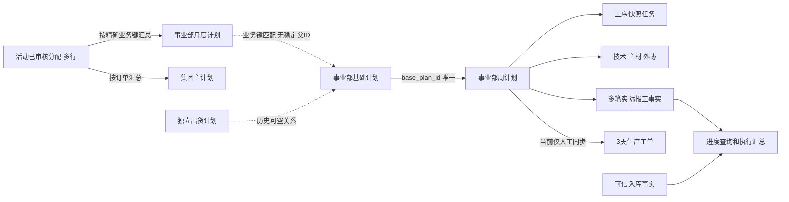
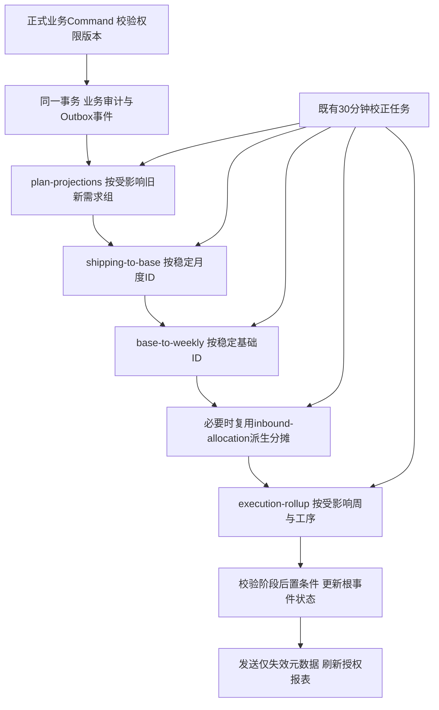

# KDOS 主计划系统上下游自动联动设计与风险评估

- 调查日期：2026-11-04，业务时区 Asia/Shanghai；主要生产只读快照为当日 20:15—20:21。
- 状态：**完整联动仍为设计；2026-11-05仅实施第一阶段1A同步可靠性代码与隔离验收，未部署生产**。1A范围及后续安全门禁见第14节；其他重大业务规则仍见第13节。
- 源码基准：`f569ccc38e926e580db78d16063334cff61a02a5`；生产 API 为 `4c9b1d3`，Web 为 `f569ccc`。两版本间没有 API 源码变更。本轮没有部署。
- 本文只记录脱敏的结构、聚合结果和规则，不收录生产订单明细、员工身份、需求数量明细、凭据或原始数据库快照。

## 1. 结论与实施优先级

### 1.1 两条链路的现状

| 链路 | 已具备 | 缺少的闭环 |
| --- | --- | --- |
| 订单分配 → 集团/月度 → 基础 | 有效已审核分配按订单、品项、事业部精确汇总；支持追加分配；集团/月度幂等更新；月度到基础有三方合并保护；业务事务写 Outbox，30 分钟校正 | 撤销/归档后的有效需求退出；通用恢复；旧键和新键共同重算；永久业务别名；月度到基础的稳定父 ID；人工数量与有效需求冲突的显式处理；整条链完成判定 |
| 基础 → 周计划 → 执行/进度 | 基础准入统一；一基础最多一周计划；子表按 weekly ID 定位；首次正数量报工锁工艺；既有快照日期重算；按实际报工 SUM 汇总 | 已生成后失去准入的处理；计划取消；开工后的身份/制造方式变更保护；来源快照与事实分离；工单的受控更新策略；Outbox 重试、租约和完成状态可信度 |

**优先级建议：先保证不能改坏生产事实、取消状态可表达、失败能正确恢复，再扩展自动联动。** 不应直接开放“上游删除就级联删除”，也不能仅调整触发频率。

### 1.2 最重要的实际证据

1. 生产存在 **11 条 Outbox=SUCCESS、相同幂等键日志=FAILED**：订单投影 9 条、基础到周计划 2 条。另有 1 条 execution-rollup 自 11 月 3 日长期 RUNNING。第 3、9 节解释代码路径；这是实际状态缺陷，但不证明当前全部下游仍错误，后续周期任务可能已补正。
2. 生产实际报工仍存在，未发现上述同步路径自动删除实际报工。当前有 25 条报工所在周计划属于非工序制造方式，3 条报工没有对应启用工序任务；现有进度查询会排除这些范围。两组可能重叠，不能相加推算受影响记录，也不能据此推断是谁或何时变更。
3. 源码确实会 UPDATE `mps_process_reports` 的计划来源快照，并更新 `updated_by/version`；**没有在该 UPDATE 中覆盖生产数量和生产日期**。风险是历史上下文及最后修改人被计划刷新改变，另有身份/制造方式变更导致事实归属和统计可见性改变。
4. 652 行验收表仍对应 634 个固定基础 ID；本次 ID/事业部/归一化键全部保留。**现有 3 组数量与验收表不同**，最新审计均为 11 月 3 日 13:28:14 的非系统 `import_updated`。必须确认这些后续业务变更，不能再声称当前“数量差异 0”，也不能自动还原。

## 2. 调查依据和数据关系

### 2.1 权威依据

以下链接以本次源码基准为准；源码链接定位定义，不能用旧文档的发布状态代替运行状态。

| 编号 | 依据 | 本次核实内容 |
| --- | --- | --- |
| E01 | [allocation-source](../../apps/api/src/modules/master-plan-system/master-plan.allocation-source.ts) | 活动已审核来源、物理行 SUM、代表 allocation_id、冲突和集团汇总 |
| E02 | [allocation-projection](../../apps/api/src/modules/master-plan-system/master-plan.allocation-projection.ts) | 事务锁、数量更新白名单、历史保留、一次性别名参数、下游事件 |
| E03 | [monthly-base](../../apps/api/src/modules/master-plan-system/master-plan.monthly-base.ts) | 业务键匹配、交期编码、audit syncValues 三方合并、零数量过滤 |
| E04 | [sync.service](../../apps/api/src/modules/master-plan-system/master-plan.sync.service.ts) | runDue/processOutbox/run、基础投影、子表来源刷新、日期和报工汇总、入库分摊 |
| E05 | [application.service](../../apps/api/src/modules/master-plan-system/master-plan.application.service.ts) | create/update/batch/import/remove、事务 Outbox、异步 PENDING 反馈、专用残余更正/恢复 |
| E06 | [config](../../apps/api/src/modules/master-plan-system/master-plan.config.ts)、[Contracts](../../packages/contracts/src/index.ts) | 准入、普通删除能力、身份只写一次、字段权限、PENDING 及进度表达式 |
| E07 | [controller](../../apps/api/src/modules/master-plan-system/master-plan.controller.ts)、[query.service](../../apps/api/src/modules/master-plan-system/master-plan.query.service.ts) | 授权入口、只读元数据/数据范围、同步状态查询；Controller 不访问数据库 |
| E08 | [工艺锁 Migration 107](../../apps/api/src/migrations/1722920107000-MpsProcessRoutingV1.ts)、[日期 Migration 108](../../apps/api/src/migrations/1722920108000-MpsProcessDueDateRefresh.ts) | 首次正数量报工持久锁定；INITIALIZE/CONFIRM/RECALCULATE_DATES 数据库保护 |
| E09 | [批次 Migration 93](../../apps/api/src/migrations/1722920093000-AllocationAppendBatches.ts)、[归档 94](../../apps/api/src/migrations/1722920094000-AllocationArchive.ts)、[月度基础 111](../../apps/api/src/migrations/1722920111000-MpsMonthlyBaseGeneration.ts)、[来源 112](../../apps/api/src/migrations/1722920112000-MpsAllocationPlanSource.ts) | 追加分配、代表父 ID、归档、基础独立于出货、跨部月度唯一性 |
| E10 | [monthly-inbound](../../apps/api/src/modules/master-plan-system/master-plan.monthly-inbound.ts)、[work-order](../../apps/api/src/modules/master-plan-system/master-plan.work-order.service.ts) | 可信入库来源与历史汇总分支、3 天工单只由用户主动同步 |
| E11 | [order-progress](../../apps/api/src/modules/master-plan-system/master-plan.order-progress.service.ts)、[dashboard](../../apps/api/src/modules/master-plan-system/master-plan.dashboard.service.ts) | 历史出货父关系/业务键回退、工序启用和制造方式过滤、报表关系 |
| E12 | [通用 Skill](../../.agents/skills/kdos-form-platform/SKILL.md)、[调度 Skill](../../.agents/skills/kdos-task-orchestration/SKILL.md)、[删除 Skill](../../.agents/skills/table-delete-standard/SKILL.md)、[任务台账 MPS-003](TASK_REGISTRY.md) | 权限/租户/审计、10 工序、实际报工、保留现有调度、撤销与删除分开 |
| E13 | [652 行验收工作簿](../../outputs/事业三部652条基础计划覆盖核对.xlsx)、[已有收尾进度](../../outputs/CODEX_PROGRESS.md)、[本任务记录](../../outputs/主计划系统修复进度.md) | 652/634 基准及后续变更，不重新导入或重做历史修复 |

本次生产诊断通过维护连接执行显式 `BEGIN READ ONLY`；关系/状态主要统计使用 `REPEATABLE READ`，设置 15—20 秒 statement timeout。n8n SQLite 使用 `mode=ro` 和 `query_only`；主机调度盘点只读。临时查询与脱敏结果在本机 `/tmp/kdos-linkage-*`，不作为部署脚本、不提交含真实业务键的 SQL。没有执行 Application 写命令、同步、Migration 或造数测试。

调查期间生产仍有正常业务：在首个事实快照后，审计出现 8 条非系统新增报工和 1 条非系统数量修改。因此不能拿跨时刻全表哈希变化认定为同步破坏；本轮所有诊断均为只读事务，也不把持续变化的生产库当作静止测试夹具。

### 2.2 实际身份和关联

| 对象 | 权威来源/人工边界 | 当前身份和真实关系 | 缺口 |
| --- | --- | --- | --- |
| 订单分配 | KDOS 人工/正式 Excel；活动、已审核、合法数量才形成有效需求；ERP 不再决定计划准入 | 每个物理 id 独立；允许同订单品项多行/多批；有 import_batch_id、来源工作表/行号、archived_at | 普通编辑/归档没有通用执行事实保护及通用恢复流程 |
| 集团主计划 | 活动分配需求；可信入库另算 | 唯一 `(tenant, order_number)`，无月度→集团 FK | 订单显示别名会形成不同身份；部分原元数据保留而不随分配更新 |
| 月度计划 | 分配按 `(tenant, order_number, item_code, division_id)` SUM | 该四列 `UNIQUE NULLS NOT DISTINCT`；`(tenant, allocation_id)` → 分配 `(tenant,id)` RESTRICT | allocation_id 仅为聚合中的代表，不是全部贡献关系；当前用代表父历史状态判冲突，其他活动行仍可能受阻；无独立月份列 |
| 出货计划 | 独立人工业务；不是基础的当前权威来源 | 有 monthly_plan_id；基础旧数据仍可能有 shipping_plan_id | 不得因名称 shipping-to-base 又改回“出货驱动” |
| 基础计划 | 月度生成＋人工维护/拆分/历史纠正；人工字段受三方合并保护 | 唯一 `(tenant, order_number, item_code, delivery_number)`；可空 shipping_plan_id；**没有 monthly_plan_id**；月度→基础按订单/品项/事业部找匹配 | 多基础批次时跳过并诊断，尚无自动分摊规则；改键可能断联或新建 |
| 周计划 | 满足统一准入的基础计划；部分周计划字段当前仍可人工改 | `base_plan_id` FK RESTRICT；唯一 `(tenant,base_plan_id)`；另有业务键唯一约束 | 基础变得不满足准入时，已有周计划也被更新扫描排除；计划属性仍无生命周期 |
| 周计划工序任务 | 新周计划的工艺快照；既有未开工快照需预览确认 | 唯一 `(tenant,weekly_plan_id,process_code)`；到 weekly 的 FK 为 CASCADE，另有工艺保护触发器 | 不能把子任务 FK 的 CASCADE 当作安全删除周计划的依据；需计划状态控制待执行资格 |
| 技术/主材/外协 | 系统建上下文，人工维护责任人、附件、异常、执行日期等 | 都按 weekly_plan_id；技术/外协每周唯一，主材每周＋五金/木作唯一；FK RESTRICT | 自动存在的占位行不等于已执行事实；外协 execution_enabled 会随制造方式改变 |
| 实际工序报工 | 每次真实提交独立事实，允许同日多笔 | id 独立；weekly_plan_id FK RESTRICT；weekly＋process 是身份，普通编辑不可改；production_quantity/production_date 可经正式纠错命令修改 | 来源冗余字段当前会被同步改写；到工序任务没有复合 FK；进度会按当前任务/制造方式过滤 |
| 3 天工单 | 用户主动从周计划同步，人工生产日期/备注保护 | 唯一 `(tenant,weekly_plan_id)`；来源字段与人工字段已有明确列表 | 当前不是四条自动任务的一部分，不得未经确认自动启动同步或覆盖人工排产 |
| 入库 | 既有 ERP staging/canonical/库存事实链 | 可信月度入库有账套/事业部/来源验证；周计划分摊按来源订单品项和交期顺序 | 分摊是派生量，不是原始库存事实；现有周分摊不是按计划状态/永久别名/显式跨部份额分配 |



实线只表示已核实的数据/计算方向，不表示全部具有复合 FK。新增关联应使用租户＋稳定 ID；当前部分旧 FK 仅含全局 UUID，服务查询仍需显式 tenant，不能把 FK 或前端列隐藏视为授权。

### 2.3 生产快照与证据解释

| 核验 | 聚合结果 | 解释 |
| --- | --- | --- |
| 月度父记录 | 无缺失父；2,176 条代表父已归档；2,081 条无活动精确同组已审核分配；8 条代表父业务键不同 | 包含合法历史保留，不可统一取消/修复；8 条不等于同组无其他有效分配 |
| 基础关联 | 747 条无精确月度业务键；48 个正数量多基础批次业务组 | 历史/人工批次需分类；不能以不存在匹配认定应删除 |
| 周计划 | 无缺失基础父；2 条当前来源快照不同且有 2 条基础现不满足准入 | 不是全表都失效；须按状态和原因逐条判断，两项计数不假设是同一集合 |
| 工艺保护 | 有正数量报工的记录未发现未锁定所属周计划 | 现有工艺结构锁应复用；不是整个计划身份/归属都已锁定 |
| 报工统计 | 25 条处于非工序制造方式、3 条无启用工序任务；191 个周计划工序累计大于当前计划 | 不能截断累计、删除事实或通过把状态写成完成来掩盖；原因需后续逐项确认 |
| 来源投影候选 | 3,989 个可处理业务组、110 个“保留历史计划或人工归属”阻断 | SUCCESS 可以包含 skipped/blocked；需业务完整性指标 |
| 集团别名候选 | 7 个按 `23XX-`/末尾 `-1` 归一化后有多条正需求的集团组 | 只是碰撞候选，不授权自动合并；需核实别名是否确为同一订单 |
| 队列状态 | 11 条成功事件对应失败日志；1 条旧 RUNNING | 有真实重试/完成判定漏洞；不能按“任务 SUCCESS”宣布全链一致 |

## 3. 现有同步机制及其真实能力

### 3.1 在线入口与依赖

- 生产 **6 项**配置均启用、间隔均 30 分钟：四条目标任务及 erp-orders、inbound-allocation。以 11 月 4 日快照为准，旧文档中 plan-projections=false 是历史状态。
- 仓库：6 个配置任务、1 个 `@Interval(60_000)` 检查器；现有 API 内持久 Outbox 消费入口与检查器共用服务。不是六个独立 Worker，也不是新队列平台。
- 运行时：本机盘点未发现 MPS 专属 systemd Timer 或匹配四条任务的 cron；n8n 17 个定义、13 个激活和 13 个当前发布版本中未发现这四条任务入口。匹配检查不替代任意外部包装脚本的全程序证明，不据此整改其他调度。
- 已确认 ERP 采集/投影用户 Timer 维持既有运行；它们与 MPS 应用任务分层，不停用、不合并、不迁移。
- create/update/batch/import/remove 在业务事务中写 reconciliation Outbox。提交后 `completeReconciliation()` 后台调用消费者并立即返回 **PENDING**，并不等待整条联动完成。
- 当前映射：分配/客户映射→plan-projections；月度→shipping-to-base 和 base-to-weekly；基础/周计划/周期→base-to-weekly；工序/主材/外协报工→execution-rollup。技术状态人工维护，不由执行汇总反推。
- 周期扫描按 sync_key 排序，**不是业务拓扑顺序**；月度同时入两个任务也没有父子阶段屏障。后续事件/周期可最终补正，但不能据此保证一次反馈完整。

### 3.2 四条任务处理矩阵（现状）

| 任务 | 输入及新增 | 修改范围 | 删除/取消/恢复 | 幂等/保护及依赖 |
| --- | --- | --- | --- | --- |
| plan-projections | 活动已审核手工/导入分配；逐物理行 SUM；创建集团/月度；不要求 ERP 明细存在 | 已有月度只改需求及其派生欠数/入库完成率；已有集团主要刷新数量汇总，不自动覆盖人工元数据 | 来源消失不删除、不停用旧计划；普通归档后的同组剩余需求还受代表父检查限制；恢复目前仅有事业三部收尾专用命令 | REPEATABLE READ＋tenant advisory/source/plan 锁、版本、审计；变化才 enqueue shipping；组内冲突可 skipped |
| shipping-to-base | 当前唯一输入为月度；正需求才扫描；无匹配则用统一编码新增基础 | 允许列白名单，基于旧自动 syncValues/当前值/新来源三方合并；未知归属保留非空人工值 | 不处理消失月度或普通 0 数量；特殊收尾可显式纳入 0；多批次不猜配；无通用停用/恢复 | advisory＋来源/基础锁、版本、before/after＋syncValues 审计；变化 enqueue base-to-weekly |
| base-to-weekly | 统一准入 5 项：客户交期、评审交期、产品属性、表面性质、制造方式；按 base ID UPSERT 周计划；仅新周计划初始化工艺 | 覆盖周计划来源字段，已有工艺只按保存快照重算 due_date；刷新技术/主材/外协上下文和实际报工来源快照；执行累计重算 | 不满足准入的既有周计划也不扫描；不取消、不删除；外协可停用但无整计划生命周期 | base 唯一键、防重复；工艺数据库锁；子表按 weekly ID；白名单不写生产日期/数量，但缺开工后身份/制造方式保护 |
| execution-rollup | 实际报工、当前启用工序、周计划需求及日期；不创建报工 | 对任务按工序 SUM 重算当日量和状态；全量时由采购单/实际入库推导外协状态；不覆盖技术人工状态 | 不清理上游取消、不创建停止状态；不恢复丢失任务；不修改报工事实 | 支持 weekly＋process scope；重复汇总只更新差异；与计划变化的根事件依赖/版本验收尚不完整 |

### 3.3 已确认的重试缺口

E04 `run()` 查到相同幂等键的日志后，不区分 SUCCESS/FAILED/RUNNING 就返回 repeated；E04 `processOutbox()` 只要 await 未抛异常就把事件写为 SUCCESS，也不检查 `skipped/status`。因此：

1. 首次执行失败，日志 FAILED，事件 FAILED。
2. 再次消费同键时，run 返回原 FAILED，没有重做业务。
3. 消费者仍将事件标为 SUCCESS。

生产 9＋2 条状态矛盾印证此路径。失败原因分类：4 条并发序列化、5 条 ON CONFLICT 约束不匹配、2 条周计划唯一约束冲突；其中约束不匹配包含历史升级期，**不据旧日志断言当前 Migration 仍缺失**。生产月度四列唯一约束及 Migration 112 已核实存在。

消费者只 claim PENDING/FAILED，没有 RUNNING 租约回收。1 条旧 execution-rollup 事件/日志仍 RUNNING，但该任务配置和较新任务已能 SUCCESS；必须补偿旧事件状态并验证结果，不能直接改它为成功。当前失败退避上限 30 分钟，不等于业务真正被重试成功。

## 4. 推荐业务边界与取消状态

### 4.1 不变量

1. 订单分配是有效需求和承接事业部的权威。需求与人工执行排期分开；人工计划不一致时产生有责任人和处理状态的差异，不能静默覆盖或忽略。
2. 已有实际报工的 id、weekly 身份、工序、生产数量/日期、原始填报者、审计、人工异常和附件，不因计划同步被重写。正常事实纠错仍经既有权限、版本、审计和重算，不被“事实保护”永久禁用。
3. 首次**正数量**有效报工后工序集合/顺序/周期持久锁定，删除或改零报工也不解锁。计划理论交期可以按保存快照重算，不代表允许更改工艺结构。
4. 更新当前计划的名称/交期/数量，不等于改写历史报工时的上下文。当前展示值与提交时快照必须区分。
5. 无活动来源≠可以删除；历史来源未知≠已取消；自动占位行≠执行事实；0 数量≠取消。缺失/不可信入库数据也不等于实际入库为 0。
6. 一基础仍最多一周计划；同订单品项可有多个合法基础批次。任何拆分需要显式数量守恒，不能让同一需求重复下达。

### 4.2 最小生命周期模型（拟议，不是现有字段）

复用 `archived_at` 表达分配退出当前活动清单。在月度、基础、周计划增加统一的持久 `lifecycle_status`：`ACTIVE / ON_HOLD / CANCELLED / LEGACY_RETAINED`。业务完成状态继续由现有执行/入库口径维护，不与生命周期混用。

- 新记录 ACTIVE；明确取消由专用 Command 置 CANCELLED；危险变更等待确认可置 ON_HOLD。
- 未证明来源归属的老记录保留 LEGACY_RETAINED，不默认当作新增有效需求，也不因一次扫描未匹配就自动取消。切换初期用兼容查询保持旧报表，逐组确认后才启用新的有效范围。
- 取消原因、取消时间、取消人至少作为同事务 `cancelled` 审计事件必填持久化；页面可由审计查询投影，初期不在每张表重复加三个字段。若实测查询/合规要求需要，再将最新取消元数据冗余到计划，不新建历史表。
- 集团活动状态由子需求聚合；无需为集团再造一套独立取消状态机。
- `execution_enabled` 保留工艺/外协配置语义。**不能靠关闭已锁定工序来取消计划**；待执行资格增加父计划生命周期判断，历史事实查询不依赖当前启用状态。
- `weeklyPlanState` 仍表达准入/生成情况，不承担取消状态；技术/工序的“已完成/进行中”等执行状态也不代替取消。

### 4.3 删除与取消决策矩阵

| 关联状态 | 推荐动作 | 保留内容/阻断条件 |
| --- | --- | --- |
| 无下游计划 | 归档来源，重算有效需求；无须创建零需求子计划 | 保留分配行、批次、审计；同组其他有效分配继续贡献 |
| 有基础、无周计划 | 停用该有效需求对应的计划；保留基础 ID/原计划量 | 人工合并/多批次归属不清时 ON_HOLD＋诊断，不任意挑一行 |
| 有周计划、未执行 | 预览影响后受控取消；阻止新派工/新报工 | 保留周/工艺/占位子行及审计；已排产工单需负责人确认 |
| 已有正报工或人工技术/主材执行 | 取消剩余需求，保留已执行事实及冻结归属 | 不物理级联；取消后新增作业报工受限，漏报/纠错另走获权补录/纠错命令 |
| 已有实际入库 | 需求取消与库存处置分开 | 库存事实不归零；退货/转单/冲销只能走对应正式业务流程；计划取消不自动发起库存写入 |
| 有采购/外协/工单关联 | 默认 ON_HOLD，显示依赖并人工确认处置 | 已确认采购单/供应商/实际入库/人工生产日期等保护；缺少可验证关联时提示“未核验”，不宣称不存在 |
| 历史归档后恢复 | 原 ID 恢复并预览同组有效需求、冲突及下游状态 | 不复制来源行、不重建同一周计划；未决库存/订单身份冲突保持暂停 |

月度取消后的**有效需求**可为 0；基础/周计划取消后原计划数量保留为历史上下文，活动查询按生命周期排除。当前欠数/待办为 0，不把原始报工或库存量改为 0。历史进度使用保留的计划基准；当前无有效需求时进度显示 `—`，不能把除零解释为 100%。

## 5. 订单分配联动业务处理矩阵（目标设计）

每次变更同时捕获旧组/新组，校验 tenant、动作/字段权限、原/目标事业部数据范围、expectedVersion；先业务提交和写事件，再按阶段处理。下表“自动”以身份已确认、无保护冲突为前提。

| 场景 | 集团/月度 | 基础/周及执行 | 人工确认与异常 |
| --- | --- | --- | --- |
| 新增已审核分配 | 解析已确认订单身份；同组 SUM，合法增量；无组才新建 | 原组有基础则按归属更新；无基础新建；满足准入才生成周 | 未审核不生成有效需求；客户/组织/别名歧义明确阻断 |
| 修改分配数量 | 重算全组，不对旧量盲增减；集团按既有订单口径汇总 | 自动所有权数量可更新；人工批次按批准分摊；重算进度 | 人工排期冲突、降至已执行以下进入确认，事实不截断 |
| 修改订单号/品项编码 | 作为身份纠正预览，不能普通自动换主键；重算旧/新两组 | 未执行且无冲突可原 ID 修正；已有事实不迁移到另一身份 | 已执行转单需保留原计划＋另建剩余需求及显式转移审计；不得把报工的品号改成新品号 |
| 修改承接事业部 | 当前有效需求按新归属重新归集 | 无执行时受控原 ID 调整；有执行时原事业部事实保留，仅剩余需求进入新计划 | 原/目标权限都验证；防止通过 snapshot 更新把历史事实暴露到另一个事业部 |
| 修改客户/其他字段 | 明确来源字段同步名称/客户等；已有人为修正则冲突提示；日期不能互相代替 | 只更新来源所有权字段；计划/执行人工字段保留 | 跨客户且已有执行为身份风险；价格/金额不得在不明确分配汇总口径时自动求和 |
| 归档/删除一条分配 | 同组剩余活动行重新 SUM；代表 allocation_id 改为另一个有效贡献行不应阻断；全部退出才取消有效需求 | 取消/减少剩余计划需求，按第 4 节保护；保留所有历史 ID | 无法确认组归属则暂停；不得依靠定期扫描只忽略消失行 |
| 撤销审核/失效 | 与有效需求退出采用同一规则 | 保留原需求历史，停止未执行需求；不删除实际事实 | 不同于物理删除；与归档共用对账谓词和诊断 |
| 恢复归档 | 原行原 ID 恢复；重算组，检查当前已存在需求是否重计 | 原已取消且身份一致的链可恢复；有冲突不新建替身 | 复用版本、幂等、归档审计；现有事业三部专用 RESTORE 不能直接当成全平台能力 |
| 同订单品项多行/多批 | 各合法物理行贡献一次；原批次追溯保留；汇总不压成一条来源 | 多基础批次总量守恒；不能每批都复制整组数量 | 分配行重复与重复提交区分，沿用文件/请求幂等，不擅自去重真实业务行 |
| `23XX-` / 末尾 `-1` | 正则只产候选；已确认永久映射到同一集团 ID 后才归组 | 不改写原分配文本、原月度/基础/周 ID；依稳定关系更新 | 多集团历史碰撞先确认存续 ID；同形不同真实订单禁止合并 |
| 下游已有生产/入库/外协 | 有效需求允许真实变化，生产事实单列保留 | 禁止自动搬迁身份/事业部、重生工艺、撤销库存 | 差异与剩余需求处理走预览确认；上游提交成功与后续待确认分别反馈 |

取消/恢复命令建议采用 `commandId + expectedVersion + reason + previewHash`，前后状态和影响清单同事务审计。分配归档继续使用既有 delete 授权；计划取消/恢复复用 update 权限并增加服务端业务能力判定和确认，不自动授予普通员工新能力，具体可操作角色由第一阶段确认。新接口只经 Application，不由 Controller 直接访问数据库；网页、导入、批量和系统路径遵守同一规则。

集团完成率继续沿用“各品项完成比例的平均、同品项跨事业部先合计”的既有口径；不擅自改为工序报工总和或金额完成率。月度生产进度的分母仍是该月度有效需求，不用已下达周数量替代。

## 6. 基础计划联动业务处理矩阵（目标设计）

“日期重算”专指按**已保存工序快照**重算理论 due_date，不重新取新路线/周期；“重算”均按事实全量 SUM，不增减累计缓存。

零需求需单独确认产品规则：推荐保留 0 数量来源/基础，不生成新的可执行待办；已有零量周计划保留历史，不因数量为 0 自动视为取消。当前准入仅定义上述 5 个完整性字段，并没有正数量门槛，本建议必须先确认后再加入执行资格，不能冒充现状。

| 场景 | 周计划新增/更新与数量 | 工序任务和交期 | 事实/确认/异常及进度 |
| --- | --- | --- | --- |
| 新增基础 | 完整且 ACTIVE 才按 base ID 建一周；未完整保留草稿 | 仅创建当次初始化工艺和相应技术/主材/外协上下文 | 无假报工；不满足准入说明缺失项；报表分开显示未下达需求 |
| 一般修改计划数量 | 更新原周，不能新建第二周；先校验归属和总量约束 | 不重建任务/周期；只重算累计、剩余、状态 | 当前计划值动态显示；历史报工快照不覆盖 |
| 增加数量 | 对已开工原周可增加需求且原 ID 不变 | 锁定工艺不变；不按新配置补工序；日期锚点未变不改日期 | 保留报工；可能由完成重新进入待报工，界面显示新增需求及审计 |
| 减少数量 | 未执行可自动；有事实需按工序分别比较，不能把各工序 SUM 当产成品数量 | 不删除已完成/已报任务 | 默认暂停自动降至实际以下并确认；确认后允许超计划事实、剩余最小 0、进度可 >100% |
| 修改客户交期 | 原周来源日期更新 | 不拿客户交期替代评审交期；不自动修改采购承诺/人工工单生产日期 | 必要时提示评审交期矛盾；无需改事实 |
| 修改评审交期 | 更新原周评审锚点 | 未开工/已锁定都可按保存集合/顺序/周期重算理论日期；不刷新结构 | 人工外协承诺不动；理论日期变化审计；延迟状态重新计算 |
| 修改产品属性 | 更新当前上下文 | 不自动替换已存工艺；未开工可预览确认路线，已报工不能改结构 | 存在工艺影响时产生待确认差异，不暗中生成任务 |
| 修改表面性质 | 同上 | 同上，保留表面处理工序历史 | 未经确认不变更执行要求；进度仍按原锁定事实 |
| 修改制造方式 | 未执行且无依赖可确认转换；已执行默认暂停转换 | 未开工预览后维护启用集合；已锁定不禁用原工序；外协有执行时不自动停用 | 防止现有 25 条一类统计消失；需要转单时只转剩余需求，不改原事实归属 |
| 修改事业部/订单/品项身份 | 专用更正预览，校验两端；未执行可受控原 ID 修正，有事实禁止直接改 | 有事实不重新生成、不把原任务套到新产品 | 新身份的剩余计划需显式关联、数量守恒；双范围权限及异常 |
| 删除/取消基础 | 当前普通 DELETE 仍禁止；新增专用取消 Command，按生命周期停用 | 父状态控制待执行，不删除或关闭已锁定结构 | 未完成需求退出；报工、附件、采购、入库、工单事实保留；有依赖需确认 |
| 周计划已经生成 | 按唯一 base ID 定位原周，更新与“首次生成”分开 | 从“是否完整”决定新建；已有周失去必填时 ON_HOLD＋原因，不静默跳过 | 不重建第二套子记录；已生成状态可追踪实际同步结果 |
| 周计划已经报工 | 数量/理论日期允许按已确认规则变更，身份保护 | 不更改工序集合、顺序、周期，锁永不自动清除 | 报工数量/日期/人/异常/原始快照不变；动态查询当前计划值 |
| 已有入库/外协执行 | 当前需求、分摊和历史执行分开 | 不重置 received、actual_inbound_date、purchase_order 等事实 | 计划小于事实时告警；库存/采购处理人工获权执行；不自动冲销 |

技术图纸交期当前只在技术行创建时写入，冲突更新没有刷新该列；这是需要明确修正的派生日期缺口。建议理论图纸交期跟随周计划技术周期/评审锚点，保留人工责任人、状态、附件、异常。主材实际入库和外协协商交期继续人工维护，不以理论日期覆盖。

## 7. 字段所有权与事实保护矩阵

| 字段/对象 | 所有权 | 自动联动允许 | 禁止/冲突策略 |
| --- | --- | --- | --- |
| 分配原始批次/工作表/行号、id | 原始来源追溯 | 按正式导入保存，不改历史批次 | 不重排来源行，不以合并删除代替汇总 |
| 月度 required_quantity | 活动有效需求 | 精确 numeric 聚合；取消后有效需求可为 0 | 人工需求修正必须回到来源或获权更正，不把历史执行量当需求 |
| 基础 planned_quantity | 需求下达，允许经确认人工拆分/排期 | 能证明自动所有权时三方合并；人工差异明确记录 | 不为追平上游而覆盖人工；来源变更与人工调整不一致进入确认 |
| 基础评审/完成日期、人工备注等 | 计划人员 | 沿正式手工命令维护 | 自动来源不足不补默认假日期；人工清空也受保护 |
| 周计划来源量、名称/交期等 | 当前基础上下文 | 按 base ID 更新；生命周期/开工保护先行 | 周计划直接维护的同名字段要明确所有权；不能编辑完又被静默改回 |
| 工序集合/顺序/周期 | 创建/显式确认的工艺快照 | 新周初始化；未开工预览确认 | 正数量报工后不可修改，不从最新全局配置重写 |
| 工序理论 due_date | 当前锚点＋保存快照派生 | 使用 RECALCULATE_DATES 模式，只变日期 | 不同时改变过程名称/顺序/周期/启用；人工承诺日期另管 |
| 实际报工生产数量/日期、工序身份、原始创建人 | 人工事实 | 汇总只读；授权纠错后重算 | 同步永不赋值；weekly/process 身份普通更新仍禁止 |
| 实际报工订单/品项/事业部/计划数量冗余 | 当前混合来源快照，建议冻结为提交上下文 | 新报工创建时由服务端填充；当前上下文通过 weekly JOIN 返回 | 停止计划同步批量 UPDATE 报工行，避免混淆历史归属和 updated_by |
| 技术责任人/状态/图纸附件/人工异常 | 人工执行 | 原值保留 | 不按附件推导覆盖状态、不清空附件/异常；占位行创建不算执行 |
| 主材 received/actual_inbound_date/人工异常 | 人工事实 | 校验后人工更新、派生状态重算 | 不因取消或重算清零/改日期；received 与日期联动校验保留 |
| 外协采购单/供应商/方式/协商日期/实际入库/异常 | 人工业务及执行事实 | 状态可按真实采购/入库派生，保留原字段 | 有执行不能仅根据新制造方式关闭而从报表消失 |
| 3 天工单人工生产起止日期/备注 | 人工排产 | 继续现有保护 | 本设计默认保留人工同步入口，不自动更新工单；需变更时先预览确认 |
| 累计、剩余、进度、状态、入库分摊 | 派生读模型 | 从可信事实重新计算，只写差异 | 不当事实回写；剩余可下限 0，实际报工不截断，0 分母为 — |

### 7.1 报工混合存储的最小调整

1. 继续使用 `mps_process_reports`，不新建第二套报工事实表，不搬迁/重建历史 id。
2. 停止 E04 `ensureExecutionRows()` 对已有实际报工的来源字段 UPDATE。现有冗余列对新报工保存提交时上下文；查询同时通过稳定 weekly ID 投影当前计划上下文。
3. Contract 明确“当前计划数量/当前交期/当前品名”与“报工时快照”；原页面 `plannedQuantity` 可继续投影当前周计划数量，历史详情提供冻结快照，避免把旧列含义不告知地改掉。当前字段仍受 read 权限裁剪，历史事业部访问不能仅靠当前计划归属。
4. 旧来源快照可能已经刷新，**不能冒充原始报工时值**。只有创建审计可证明时才受控恢复；否则标记“迁移时保留上下文/原始上下文未知”，不推算历史值。
5. 真正纠错只经已有 Application Commands，审计 before/after、actor、reason、expectedVersion；计划同步不得污染报工最后修改人。必要的计划上下文变化记到计划自身审计。
6. 旧身份/工序/制造方式不一致记录先只读分类，不自动删除或改写。锁定工艺使用持久锁＋正事实校验双保护。

## 8. 技术设计：复用现有联动引擎

### 8.1 事务事件与依赖顺序



基础直接变更从 W 进入，事实纠错从 R 进入；erp-orders 独立继续运行，不为计划联动重扫 ERP。入库阶段仅计算授权范围内的派生量，不能借联动触发正式源系统采集、采购/库存冲销。

复用当前 `mps_reconciliation_outbox.scope_json` 和 record_id：保存事件类型、根/父事件、源实体 id/version、旧/新身份组、变更字段、受影响计划 ID、阶段及冻结后的输入摘要；禁止带 Token 或完整敏感报工内容。批量修改按一次命令聚合所有受影响组，不因 requestId 去重而丢掉后面的行。删除前在同一事务保存旧组身份；恢复明确 RESTORE，不伪装 CREATE。

父阶段业务事务内同时写下一阶段事件，避免“父提交后进程崩溃、子事件没生成”。不再同时无序投递依赖阶段。现有任务编码/执行函数/周期校正继续复用，不新建同步引擎、队列数据库或 n8n 业务规则。

### 8.2 幂等、并发与失败

- 逻辑事件键：`tenant + commandId/requestId + resource + sourceVersion + stage + scope`；物理重试有独立 attempt。只把已校验 SUCCESS 当幂等完成，FAILED 必须可重试，RUNNING 必须有有效租约；disabled/skipped 不当成功。
- 保留失败尝试日志，不覆盖掉旧失败证据。可复用现有日志每尝试一行，attempt 幂等键区分，`metrics/scope_json` 关联逻辑键与 root；不新建日志表。旧幂等键兼容读取，不重放所有历史成功事件。
- 每个阶段执行后检查返回 outcome 和后置条件；FAILED/需要人工确认/源已变更/来源缺失均返回真实原因。计划成功、子阶段待处理、部分阻断和事实已保存分别反馈。
- 数据库 advisory lock/行锁作为跨进程依据；内存 Set 只减少单进程竞争。统一锁顺序：tenant/需求组 → 来源 → 月度 → 基础 → 周 → 工序；排序锁相同级 ID，避免残余更正和正常投影的锁顺序相反。入库与分配现有共享锁也纳入顺序。
- 结合现有 `version/updated_at/attempts` 做 CAS 租约与 fencing；开始可设 120 秒租约、30 秒心跳，再按测量调整。超时 worker 不得提交过期结果；RUNNING 到期检查关联日志/后置条件后安全重新排队，不能直接 SUCCESS。
- 只 claim 能及时处理的批量；同一 scope 串行，不同 scope 有界并发。数据库唯一键保留为最后防重复保护，冲突不能无条件吞掉。
- 临时序列化/死锁/网络故障退避重试并加 jitter；参数/授权/身份歧义转人工诊断，不无限盲重试。单次上限、尝试次数和待处理时长可配置，超限继续保留可见 FAILED/人工处理状态。
- 源版本变化时，以当前有效状态重算受影响旧/新组并记录 superseded；不把旧事件的过时数量回写新版本。来源 id、版本、目标快照及 hash 不兼容时重新预览。
- 派生同步不再把自己的 snapshot 更新当新业务事件反向触发来源链；事件合并以逻辑版本和 scope 为界，不合并不同阶段的完成证据。

### 8.3 完成状态不能仅看 SUCCESS

根事件在现有 scope/metrics 记录各阶段：等待、执行、已验证、阻断/失败；状态扩展先与既有四态 Contract 兼容，不能仅加数据库枚举而漏改前端。

后置条件至少包括：

1. 有效分配总量与对应月度需求一致，包含旧键退出；分组阻断计数为 0 或明确待确认。
2. 每个已确认月度→基础分摊一致；保留人工差异时返回 blocked，不宣称全部同步成功。
3. 每个满足准入的活动基础只有一个周计划；不满足准入的已有周明确暂停/缺失原因。
4. 来源和派生版本已覆盖本事件，子阶段已完成；取消状态在待办、生产进度、Dashboard/导出一致生效。
5. 报工核心事实指纹及工艺结构保护检查通过；改变需求只改变分母/当前上下文，不删事实。

监控按 tenant/stage/scope 显示最长等待、租约超时、尝试数、失败类型、处理数量、跳过/保护数量和对账差异；告警复用已有通知体系，调度本身不在本轮改动。业务写入已提交时，后续失败不能显示成“保存失败”或回滚用户已提交事实。

### 8.4 性能与报表

当前 base-to-weekly 每次扫描所有获准基础并逐周刷新子表；单次生产观察约数十秒，不能把它直接放回每次 HTTP 保存等待。事件优先稳定 ID 小范围，周期保留全量校正；分页 keyset、每批 100—200 作为初始测量配置，批次事务与恢复点必须可追踪。

基于 `EXPLAIN` 再加 tenant＋parent/group 索引，禁止无依据引入基础设施。月度关联优先新稳定 FK，旧业务键仅为有标记的兼容回退，不能同时两条 JOIN 重复 SUM。报表授权、read∩export、字段权限和 tenant 在服务端重验；WebSocket 只发失效元数据。报表里的“历史事实”和“当前有效需求/待办”各自有清楚范围，不让 CANCELLED 或制造方式变化隐藏历史事实。

## 9. Migration 评估与历史兼容

**本轮不执行 Migration；推荐完整方案需要小范围增量 Migration，不能仅靠前端或定时频率解决。**

| 拟议变更 | 必要性与最小范围 | 历史策略 |
| --- | --- | --- |
| 月度/基础/周 lifecycle_status | 当前没有能表达取消/暂停/未知历史的持久状态；不能用数量 0、执行完成或 execution_enabled 替代 | 加可兼容状态，先保留旧读行为；按证据分批确认 ACTIVE/LEGACY_RETAINED，不批量取消无来源历史 |
| 基础 monthly_plan_id | 现有仅 shipping_plan_id，不足以稳定表达新权威父关系 | 可空复合 tenant FK＋索引；精确唯一证据才回填；允许一月度多基础，不加单月度唯一约束；多批次先确认分摊 |
| 月度 group_plan_id | 永久订单别名必须锚定存续集团 ID，报表不能继续只用文本回连 | 可空复合 tenant FK，保留旧 id/文本；历史分组冲突不任意归并 |
| 已确认订单别名映射 | 现有 `mps_order_line_source_aliases` 解决 ERP 来源身份，不是计划业务别名；一次性 groupPlanAliases 不会持久覆盖周期任务 | 若采用本推荐，可最小新增 `mps_plan_order_aliases`：tenant＋原始订单别名唯一，group_plan_id、确认审计/版本；只录已确认关系。当前 7 组候选不自动全部导入 |
| 月度有效需求唯一性 | 别名启用后四列原始文本唯一不足以阻止同一集团品项事业部重复需求 | 完成显式归属后增加以 group_plan_id 为锚的有效组唯一索引；历史冲突先处理生命周期，保留历史 id，禁止为建索引删行 |
| Outbox 租约/根事件 | 优先复用 scope_json、version、updated_at、日志 metrics，不必新增第二套表 | 如现有字段不能证明 worker fencing 或查询性能不够，再加 lease owner/root 索引等；保留旧事件读兼容，不批量改成功状态 |
| 报工上下文分离 | 停止同步 UPDATE、查询当前上下文、冻结现有列可先不改表结构 | 不强行回填无法证明的原始快照；额外完整提交快照 JSONB 仅在产品确定要保存原始交期等现有未存字段时新增 |

上述别名表是有当前缺口证据支持的最小新增，**不是本轮已批准的数据库改造**；第 13 节需先确认永久别名口径。若业务选择只做提示、不跨别名联动，可先不建该表，但该选择不能宣称已解决别名重复。

新 FK 均考虑 tenant＋id，先校验孤儿/跨租户再 VALIDATE；已有部分单列父 FK 可以后续定向补强，不借本项目进行全库结构重构。增量迁移不做破坏性 down；应用回退必须能识别取消/历史状态及新月度唯一键，不启动会重新激活取消计划的旧版本。

## 10. 风险评估

等级：P0＝进入自动变更前必须具备保护的事实/授权底线；P1＝会产生错误需求、错误执行或恢复不可靠，必须在对应阶段上线前解决；P2＝受控可观测性/性能问题。等级表示后果，不表示已发生相同后果。

| 风险/级别 | 触发场景与影响 | 现有保护 | 缺失及实际证据 | 推荐措施 |
| --- | --- | --- | --- | --- |
| 1 历史报工被改写或统计丢失 **P0** | 上游换品项/事业部/制造方式，事实被重新归属或从汇总消失 | 数量/日期不在同步 UPDATE；报工身份普通不可改；FK RESTRICT | 快照可改；制造方式/任务过滤，现有 25/3 条范围；无通用已执行身份保护 | 冻结事实上下文、当前值查询投影；开工身份变更阻断；历史统计不靠当前启用 |
| 2 别名重复集团 **P1** | 周期用原字符串重建另一组，需求重复 | 精确字符串唯一；专用收尾可一次性合并汇总 | 无永久计划别名，7 组归一化正需求碰撞候选 | 确认后持久映射到存续集团 ID；歧义暂停，原文本/历史 ID 保留 |
| 3 自动覆盖人工字段 **P1** | 上游数量/属性更新覆盖人工排期或清空意图 | 月度→基础三方合并；子表人工列白名单保护 | 周来源字段直接覆盖；三方值相等只能推断所有权，不能完整表达人工意图 | 字段所有权合同＋人工更改审计标记/冲突；源量与执行分摊分开 |
| 4 周工艺重生 **P0** | 制造方式/路线更新删已报工工序 | 新周初始化、正报工锁、确认与日期写模式触发器 | 计划生命周期/制造方式并未一并锁住，不能靠锁保证事实统计可见 | 保留现有锁；取消走父状态；未开工预览、已开工只调整理论日期 |
| 5 计划小于报工 **P1** | 需求减少使进度>100、错误截断或自动完成 | SUM、剩余 GREATEST、允许超计划录入 | 已有 191 个累计超过计划的工序；没有降量影响确认合同 | 逐工序比较、超产异常/确认；不跨工序相加、不截断事实 |
| 6 分配删除后无效需求残留 **P1** | 最后一行归档/撤审，旧月度/周继续生产 | 分配软归档、历史保留、代表 FK | 无 absence/cancel 分支；零需求普通基础扫描排除；历史汇总分支可能继续保留需求 | 旧/新组重算、取消状态贯穿待办和汇总；来源未知历史分开 |
| 7 归档恢复重复需求 **P1** | 复制旧行或另建子链，周期再次生成 | 专用三部收尾有版本、幂等、归档批次和重复校验 | 无通用恢复，代表父/聚合成员语义不清 | 原 id 恢复、成员重算、冲突预览，禁止用 CREATE 替代 RESTORE |
| 8 跨事业部变更破坏事实/权限 **P0** | 原报工随快照移动，旧/新员工访问范围变化 | 写权限/数据范围、tenant 谓词；工艺锁 | 普通上游更正不统一检查执行事实，旧 FK 部分单列 | 双事业部授权；已执行原归属冻结；剩余需求受控转移，不迁事实 |
| 9 外协/采购/入库/工单受损 **P0** | 换方式后外协停用；取消自动清采购/库存；工单排产被改 | 外协/主材人工列保留；真实入库独立；工单仅人工同步 | 外协停用缺执行判断；跨部/别名/取消后的库存分摊不完整；不是所有外部采购都可核验 | 依赖清单＋阻断/确认；派生分摊重算与事实区分；不自动冲销/启动工单同步 |
| 10 即时和周期并发 **P1** | 同组两个任务/多个 API 重叠、分阶段看旧数据 | advisory/行锁/版本、局部内存 Set | 生产有序列化和唯一冲突；锁顺序、任务拓扑、跨进程租约未闭环 | 统一锁序、数据库级 scope 锁、拓扑子事件、过时版本重算 |
| 11 Outbox 失败或重复 **P1** | FAILED 日志幂等返回被写 SUCCESS；重启留下 RUNNING | 事务 Outbox、唯一键、SKIP LOCKED、退避 | 已证 11 条矛盾、1 条旧 RUNNING，无 lease 回收 | 只复用已验证成功；独立 attempt、租约/fencing、状态迁移与结果验收 |
| 12 大批量性能 **P2** | 每次保存触发全租户多表/逐周循环、审计扫描与锁等待 | HTTP 已异步；无变化只写差异；有限 claim | base-to-weekly 仍全量并逐行子查询；20 个 claim 串行处理可能等待较久 | ID scope、批处理、心跳、有界并发、索引/EXPLAIN；30 分钟全量校正保留 |
| 13 SUCCESS 但跨表数量不一致 **P1** | skipped/blocked、人工量保留、依赖乱序/失去准入，前端误称完成 | metrics、异常表、保存返回 PENDING | 当前 110 个保护阻断、2 条周来源差异；无根事件全部阶段验收 | 阶段水位/后置条件、差异计数、阻断反馈，不能只看配置 last_success |

没有证据支持“现有同步会直接覆盖 production_quantity/production_date”或“全部历史报工已丢失”的结论；本设计防止的是已观察到的归属/可见性问题及扩大自动联动后的潜在破坏。

## 11. 三阶段实施方案

本轮在设计交付后停止。阶段二依赖阶段一规则/门禁验收；阶段三依赖稳定需求/父关系，不能提前开启后续自动写入。

### 第一阶段：联动规则及历史保护

- **任务**：确认第 13 节决策；字段所有权和事实依赖判定统一；取消/暂停/恢复状态合同；已报工身份/制造方式保护；冻结报工历史上下文与当前投影；修复 Outbox FAILED 被误记成功和旧 RUNNING 不恢复，建立阶段结果模型。既有异常仅诊断，不自动修复。
- **代码范围**：E04/E05/E06/E07、报工 Query/Spreadsheet、相关权限 Contracts；状态 UI 只使用共享表格和既有反馈机制；不改导出规则本身，只保证新生命周期范围一致。工艺数据库保护仍复用 Migration107/108 对应规则。
- **表**：monthly/base/weekly 的生命周期；process_reports 只调整写入/查询边界；reconciliation_outbox、sync_logs、audit_logs、data_exceptions。**需要增量 Migration：状态字段/必要约束；队列元数据优先复用现有 JSON/版本。**
- **兼容**：历史不按“无来源”自动取消；旧报工快照不伪造原始值；旧事件不全量重放；先只读列出失败/超时事件，后续获权按当前版本校验再补偿。
- **测试**：隔离 PG18；正报工锁、撤销报工不解锁、原/目标事业部权限、计划刷新不改事实/actor、取消不删除事实、手工纠错仍可用；FAILED→重试成功/持续失败、跳过/禁用、RUNNING 超时/迟到 worker、多实例及崩溃恢复。使用合成事实，不以生产执行测试证明。
- **验收**：计划同步事实核心差异为 0；锁结构差异为 0；失败不会变成功；取消与零需求/完成分离；保存与子同步结果明确。新取消状态与全部消费者兼容后才能激活取消写路径。
- **风险/回滚**：P0 保护遗漏或状态读范围不一致；先兼容部署、按批准范围开启，不停现有其他任务。回退只关闭本阶段新增写路径并保留事件/状态；不能回到会重写历史快照或忽略取消状态的版本。

### 第二阶段：订单分配到基础计划

- **任务**：永久订单身份/别名；代表父改为贡献组语义；原/新组事件；新增、数量、客户/名称、归属、归档、撤审、恢复全闭环；group/月度→基础稳定关联；人工多批次数量分摊与冲突反馈；集团/报表有效范围统一。
- **代码范围**：E01/E02/E03/E05、delivery-code、月度入库、order-progress/dashboard、Contracts/查询/正式导入预览；将三部收尾保护中的通用部分提取成可复用策略，保留专用命令历史合同，不把一次性数据修复常量作为通用规则。
- **表**：allocations、group、monthly、base、alias（若选择永久映射）、audit/outbox/exceptions。**需要 Migration：monthly.group_plan_id、base.monthly_plan_id、复合 FK/索引、确认后的有效组唯一性；最小别名表按决策启用。**
- **兼容**：保留原集团/月度/基础 ID、交期编码和原始文本；唯一匹配才回填；历史多批次/别名歧义保持显式未决；652/634 固定 ID 不重新生成。人工字段三方合并继续复用，冲突必须可见。
- **测试**：第 5 节全部场景，跨部/追加分配/审核切换、归档代表但其他成员仍有效、最后成员退出、恢复两次、请求/文件幂等、旧键/新键并发、别名碰撞、多个基础批次、零需求和真实入库独立；每种分支检查 ID/数量守恒/审计/无事实变化。
- **验收**：同组有效物理行贡献一次；旧需求退出；人工拆分和别名冲突不被虚报成功；根事件完成时集团/月度/基础数量/关系满足后置条件；周期重放无重复计划/审计/队列抖动。
- **风险/回滚**：别名/人工批次误归组是主要 P1。读预览比对通过后逐范围启用；应用回退保留新关联/别名/状态和审计，不删关联、不删冲突行来迁就旧唯一键；对已确认历史变更仅用受控逆向命令。

### 第三阶段：基础计划到周计划及报工/进度

- **任务**：新建准入与已有周计划更新拆开；取消和缺字段暂停；数量/交期更新；未开工工艺预览、已锁定理论日期；技术理论交期；外协执行保护；稳定父关系覆盖进度/待报工/报表；依赖阶段和范围化性能；3 天工单默认维持人工同步，按确认决策额外处理来源变化提示。
- **代码范围**：E04 的 baseToWeekly/ensureExecutionRows/recalculateSnapshotDueDates/rollup、E05 写命令、E06 准入/PENDING/投影、work-order、monthly-inbound、query/dashboard/order-progress 及相应 Contract/正式 Excel 通道。
- **表**：base/weekly/weekly_process、technical/material/outsourcing、process_reports（读事实）、work_orders、outbox/logs/exceptions；库存事实只读。**通常复用前两阶段结构，无须新建执行表；若决定保存额外原始交期快照或补复合 FK，另列最小 Migration，不能临时追加破坏性改表。**
- **兼容**：原 weekly 和任务 ID 保持；从不自动重初始化已有工艺；10 工序 registry 唯一；不复活已取消历史需求；25/3 统计异常范围逐项预览确认，不猜测修复。
- **测试**：第 6 节全部场景；首次准入→唯一周计划→真实模拟多笔报工→改量/改交期→重查进度→取消/恢复；正报工后换方式/跨部/换品项被保护；外协采购/入库/附件不变；删除/纠错报工累计重算；重复/并发/断电恢复、页面/Excel/报表同范围。
- **验收**：基础仅保存一次即可追踪下游结果；新建/更新/暂停分支明确；任务不重生、事实不被同步写入、历史进度可见；当前月度分母不被已下达周量替代；全链定时校正与事件重放结果一致。
- **风险/回滚**：数量分母变化、制造方式和生命周期统计口径是主要 P0/P1；保留数据库保护与事实校验，回退兼容应用，派生值可从事实重算，禁止恢复整库覆盖上线后的新报工。

## 12. 历史基准、验收和回滚

### 12.1 652/634 基准的正确使用

- 基准资产：652 条原始行、634 个确认归一化组、634 个固定基础计划 ID；原始重复行、0 数量明细、订单别名、恢复归档、数量纠正及原计划关联全部保留。
- 本次按验收表内**固定基础 ID**而不是再次模糊匹配查询：634 个均存在，事业部与归一化品项身份均一致；3 组数量不同且有后续人工导入审计。这些是后续变更待确认项，**不能直接冻结为原验收值，也不能自动接受成新基准**。
- 阶段一由业务确认 3 组是否为合法需求/执行调整；附受控变更记录，维护“原始验收基准＋批准后的增量”双层比较。不得改写原 Excel 来消除差异。
- 后续对照覆盖分配原 id/批次、集团/月度/基础/周 ID 和关系、有效需求量、每周每工序实际报工量、报工日期/人/异常/附件、锁定工艺、实际入库/采购/工单、审计链。生产明细指纹留受限证据目录，不上传公开仓库。
- **既有报工不存在差异**不能靠行数判定，应按事实 id 和核心字段逐项/哈希比对；并发业务写入按正式命令审计区分，不能把正常新增误报为同步破坏。

### 12.2 未来开发的验收门禁

| 维度 | 必须通过 |
| --- | --- |
| 来源 | 新增/改量/改键/归档/撤审/恢复/追加批次/跨部/别名的矩阵分支；有效需求守恒，无重复集团/月度/基础 |
| 计划 | 多批次分摊、人工清空、已有周失去准入、0 需求、取消/恢复；保留稳定 ID 和历史编码 |
| 实际事实 | 同日多笔报工，正报工锁，计划增减/日期变化不改事实；已有入库/外协/工单时保护；正常获权事实纠错仍生效 |
| 汇总 | 每工序 SUM，月度总需求分母，当前/历史范围分开；取消后待办停止、历史仍可见；工序方式变化不吞历史事实 |
| 异步 | FAILED 真重试、旧 RUNNING 恢复、乱序/重复/并发/节点崩溃/部分成功/超时；根阶段后置条件，不以配置 SUCCESS 代替业务验收 |
| 权限 | 用户/字段/数据范围和 tenant；跨部两端校验；恢复/取消专用能力；API/导入/批量/系统任务不绕过相同策略 |
| 性能 | 隔离代表性规模测量耗时、锁等待和SQL计划；事件小范围，不每保存一次扫全租户；不阻断正常报工 |
| 历史 | 652/634 原基准＋批准增量、历史归档、正/0 数量、多计划批次、未知来源保留；重放后无新重复、事实差异 0 |

### 12.3 数据安全与回滚

本轮只读，不做备份/同步/部署操作。未来每阶段按实际风险保留部署前数据/关联/事实指纹及可用备份，先隔离验证，再经正式部署门禁；不默认重跑整套 ERP、seed 或旧迁移。

非破坏性加列/索引优先；有冲突就停止迁移，不能删数据使迁移通过。回退应用需理解新状态和唯一键；业务变更回滚用版本化、审计的逆向 Command，保留新发生事实。报工/库存事实不回滚到整库旧快照；灾难恢复另按备份恢复流程处理。派生累计/进度可重新计算，但必须先修复事件状态和依赖，不在生产直接 UPDATE 假装恢复。

所有旧失败/超时、3 组基准差异、7 组别名候选、25/3 统计范围问题，本轮均只记录，**没有自动处理任何生产记录**。

## 13. 需要用户确认的重大业务决策

| 决策 | 推荐方案 | 不确认时的安全默认 |
| --- | --- | --- |
| 已报工后减少/取消需求 | 有效需求真实退出，保留原事实；降至执行以下、取消执行中计划先预览确认并留原因 | 暂停自动执行变更，显示差异，不截断实际 |
| 跨事业部/品项身份转移 | 无执行可受控更正；有执行原身份保留，只转剩余需求且显式留关联 | 阻断直接改身份，原事实/权限不迁移 |
| 基础人工数量与分配需求不一致 | 分配拥有需求；基础允许人工拆分，但总量差异必须有批准/原因；同步不能默默覆盖 | 保护人工量、生成差异，链路不宣称全部完成 |
| 多基础批次如何分摊 | 按既有人工分配/批准方案；未指定不等比分摊、不复制整组需求 | 保留现状，要求确认批次映射 |
| 永久订单别名 | 只接受已确认的一对一 alias→存续集团 ID；复用旧 ID，允许原始订单文本不同；最小映射表 | 仅提供候选诊断，不按正则自动合并 |
| 已有采购/库存/工单的取消 | 计划退出与采购/库存处置分开；负责人确认，复用正式撤销/冲销流程 | ON_HOLD，不自动退货/清采购/关闭有执行外协 |
| 3 天工单是否随源自动更新 | 本设计保留现有人工同步；先给来源变更/取消提示，再由获权用户预览同步 | 不新增周期或事件自动写工单 |
| 已取消后的漏报/纠错 | 正常新增作业停止；原事实纠错与补录通过专用权限/理由/版本审计 | 不开放普通新作业，保留原记录可查，不删除既有事实 |
| 零需求是否生成周计划 | 保留零量来源/基础，默认不新增可执行周/工序待办；已存在周保留事实，0 不等于取消 | 不自动生成新执行需求，规则确认前不改现有准入 |
| 旧记录的原始上下文无法证明 | 保留现值并注明未知；有创建审计才受控恢复 | 不把推测当历史，不批量重写 |
| 652 基准中 3 组后续人工变更 | 逐组确认导入是否获批，形成批准增量，不改原验收表 | 保留当前生产值和原验收值，两者差异可见 |

**第一阶段建议先确认前三项与取消/恢复权限，落实事实保护及可靠重试门禁。本文设计完成即停止，不自动进入任何开发、数据补偿或发布。**


## 14. 第一阶段1A：同步可靠性实现（2026-11-05，仅代码及隔离验收）

### 14.1 范围和实现

本节由用户单独授权，只修复同步框架。没有开启取消/删除/恢复、别名迁移、数量/关联改写或完整联动；没有部署，没有执行生产Migration/同步/历史补偿，也未改n8n或其它调度。2026-11-05显式REPEATABLE READ READ ONLY复核仍为11条Outbox SUCCESS/日志FAILED及1条旧execution-rollup RUNNING，诊断原件仅保存在受限ignored目录。不能由旧FAILED推断业务写入未发生。

- 原MasterPlanSyncService入口继续使用，内部MasterPlanSyncRunner只封装原数据库队列及六项任务的执行协议，不是新增任务系统。原60秒检查器、6项任务及30分钟配置不变。
- FAILED同键重新领取会增加attempts/version并实际进入原业务命令，前次状态/错误在audit_logs保留；只有本协议已验证的SUCCESS（attempts>0、同租户/任务/范围）可复用。旧无证明SUCCESS只阻断，不自动重做。
- scope_json绑定日志的实际执行范围；同scope事件仍合并一次执行，但为每个事件分别建立/确认日志，不再用第一条日志替所有事件虚报成功。每轮最多20事件，准备执行下一组时才领取，不提前占住排队组租约，同轮不反复领取相同事件。
- 业务事务先锁住并验证config/log/outbox的version和租约，原六任务使用同一EntityManager，成功状态、业务变更、日志、Outbox和审计同事务提交。失败先回滚业务，再以当前所有权记录FAILED；旧代际不能回写成功、失败或异常记录。
- 不仅防止状态覆盖：事务行锁与数据库超时使旧业务事务也不能迟到提交。租约默认5分钟，statement_timeout最多120秒、idle_in_transaction_session_timeout最多30秒、transaction_timeout为5分钟、lock_timeout最多5秒；测试可在独立Runner中缩短。崩溃或停顿释放事务锁后，下一轮重新执行，不直接把RUNNING改成功。
- 既有plan-projections保留REPEATABLE READ。使用有界租约和事务锁，不在独立连接上心跳改写同一config/log行，避免心跳导致RR快照每次提交都出现40001。超时的长任务将回滚并保留可诊断状态，不能靠无限续约冒充正常。
- 消费者严格校验返回结果和数据库中每事件的成功日志/Outbox；仅“未抛异常”或返回对象不足以确认成功。事务提交ACK丢失时也不会用迟到失败覆盖已经提交的SUCCESS。
- SKIPPED/BLOCKED/DISABLED为内部结果，持久化仍兼容既有状态枚举：日志/Outbox为FAILED并记录原因，配置为FAILED或DISABLED；不擅自扩展表格状态合同。受保护投影skipped、月度基础base_conflicts不能作完整成功；ERP准入blocked_by_*是合法输入过滤，不据此误判所有ERP任务失败。允许已受保护的有效部分进度提交，但明确不是整阶段完成。
- 手工入口非SUCCESS返回409，沿用现有页面错误处理，防止旧页面把正常返回的BLOCKED提示为“同步完成”。Application和导入接口保持原样；原系统消费者仍扫描待处理租户元数据，按事件租户分别设置事务上下文，避免非默认租户崩溃后无人恢复。原权限校验和异步PENDING反馈保留。

这一级“已验证成功”表示该同步命令及其结果已原子提交；不等同于设计8.3节的整条业务链、根事件子阶段及数量守恒验收，后者不在1A范围。

### 14.2 最小Migration和历史边界

新增Migration118，仅5个元数据字段和3个索引：三张既有表各加nullable lease_expires_at；sync_logs加attempts（旧记录默认0）和scope_json。原version复用为代际fence，无新表、无历史状态更新/回填、无业务数据DML。缺少显式期限和尝试证明时，单凭旧updated_at/version不能区分旧无租约RUNNING及新受管租约，因此需要此最小增量。

- 历史RUNNING且lease_expires_at=NULL不进入自动恢复；旧11条SUCCESS事件不在待消费集合。本轮生产全部保留。
- 仅本协议领取并具有期限的过期RUNNING可重新执行；过期日志先记FAILED/LEASE_EXPIRED并审计，随后同键的新attempt真正执行，只有事务验证后才记SUCCESS。
- 不提供破坏性down：回退应用必须保留元数据/审计；禁止直接退回会误成功的旧消费者。未来上线前需确认全部旧二进制消费者已退出，不能混跑不理解fence的旧软件。迁移和运行启用需另行授权，本轮不得执行。
- 未来启用时应先复核既有保护跳过/冲突计数；这些阻断现在会诚实显示未完整完成，不改变原保护规则或为通过而覆盖人工数据。

### 14.3 隔离验收与复现

使用专用PostgreSQL18容器（network=none，数据库目录tmpfs，仅绑定专用Unix socket），数据库固定mps_sync_1a_test、schema固定sync_1a_fixture；测试环境变量缺失时真实DB套件明确skip，有值时严格限制到test/mps_sync_reliability/pg_socket，绝不读取生产连接设置。夹具为合成用户/事业部/计划和报工，没有复制生产事实。

- 实际应用原MPS结构/工艺保护及Migration118，覆盖FAILED→成功、连续失败、租约超时/崩溃、旧Worker迟到、真实事务超时回滚、两Worker竞速、忙等待、重复确认、同scope合并每事件日志、无效/跳过/禁用/阻断、租户/范围隔离、30分钟兼容、审计失败回滚。
- 实际调用原基础→周计划与报工汇总：重复任务不生成第二周计划或第二套10工序；真实合成报工全行及持久工艺锁保留。注入23514后没有残留部分周计划，同键第二次实际执行成功；保留原SQLSTATE，不由清理SET LOCAL的25P02覆盖。
- 定向API套件/类型检查/lint/build最终结果及Git SHA以outputs/主计划系统修复进度.md首节为准；不以生产只读快照冒充写入测试，也不为本轮运行Web或业务页面生产写入验收。

```bash
# 仅已启动的专用隔离PG18；不可替换为生产socket或连接串
KDOS_SYNC_RELIABILITY_TEST_SOCKET="$PWD/test/mps_sync_reliability/pg_socket" \
  pnpm --filter @tracker/api exec jest --runInBand --runTestsByPath \
  src/modules/master-plan-system/master-plan.sync-runner.postgres.spec.ts \
  src/modules/master-plan-system/mps-sync-leases.migration.spec.ts \
  src/modules/master-plan-system/master-plan.sync.service.spec.ts \
  src/modules/master-plan-system/master-plan.application.service.spec.ts \
  src/modules/master-plan-system/master-plan-spreadsheet.service.spec.ts
```

### 14.4 11条矛盾事件与1条旧RUNNING的后续建议（本轮不执行）

1. 保存既有事件、幂等键、执行日志、错误分类和相关事实指纹；只读检查后续周期是否已补正、当前版本/数量/身份/工艺锁及报工事实。不要仅凭日志失败认定未写入。
2. 如当前结果已正确，保留原始失败证据，走另行批准的人工核验/诊断结论，不直接把旧日志或RUNNING改SUCCESS伪造一次执行。
3. 如仍存在差异，先核准真实需求与保护边界，再另行授权有范围的Application补偿命令，使用新的可追踪请求；必要时明确审批旧事件转待处理的元数据迁移，不直接清幂等键或全量重放。
4. 对旧RUNNING先确认无旧进程/事务仍在执行，保存诊断后按批准流程确认中断，再决定是否真正重跑。没有租约的历史记录不会因118的NULL字段自动被接管。
5. 每个补偿事务都比较生产事实/工艺锁/稳定ID前后差异，并确认日志与Outbox一致；任何不确定的既有副作用先人工核实，不以强制同步“修状态”。
